# 2026 First Aid Rules (Section III of the 2026 Unified Mine Rescue Rules)

Edition: 2026, "Approved 1/6/2026"  
Source: https://www.msha.gov/sites/default/files/Mine%20Rescue/III-2026%20First%20Aid%20Rules.pdf

**Written exam:** 15 multiple-choice questions taken from the First Aid Statements of Fact; each question has a blank for a key word (no more than two consecutive blanks); three choices; no "none of the above"; 20 minutes; taken by the three working team members. (First Aid Written Examination rules 2–4 (p. 7))

> The official PDF is a redline: red text is new for 2026 and red struck-through text is deleted. Deleted text was removed automatically (red glyphs crossed by a strike rule); additions are kept. Deletions removed: PDF p6: “moving on to their next prospective station”; PDF p8: “on designated First-Aid Field ., this will be done in conjunction with the First-Aid equipment being laid out if the team wants to do that. At the end of the 5 …”; PDF p9: “Eleventh”; PDF p10: “Eleventh at least two s”; PDF p12: “Information for this table taken from Chart figure 27.5– Start Triage System IMMEDIATE DELAYED MINOR DECEASED”; PDF p13: “>30 per minute <30 per minute <30 per minute Absent Capillary refill >2 seconds or radial pulse absent Capillary refill <2 seconds or radial pulse present Capil…”; PDF p16: “, masks, if there would be contamination due to other contamination (such as contacting multiple patients) broken- splint”; PDF p20: “set break the first line for 60 pounds pressure The release line shall be straight. 1 Too many or too few compressions can be detrimental to patient. 1”; PDF p21: “10-12 breaths in each 58-62-second period (through .7-literline on new manikins) 5. Failure of rescuer to state that patient is breathing and has a pulse when a…”; PDF p26: “NO SPINAL INJURY - Give 30 compressions RESCUERS SWITCH r s shall provide an envelope indicating”; PDF p27: “A. Compressions are at the rate of 100 to 120 per minute B. Down stroke for compression must be on or through compression line C. Return to baseline on upstroke…”; PDF p28: “9. RESCUER APPLIES THE AED (DURING THE FIFTH CYCLE OF COMPRESSIONS) □ □ □ D. Rescuer continues compressions while other rescuer turns (simulated) on AED and app…”; PDF p29: “TWO-RESCUER CPR WITH AED (WITH SPINAL INJURY - MANIKIN ONLY) PROCEDURES CRITICAL SKILLS 1. RESCUER ESTABLISH UNRESPONSIVENESS □ □ □ □ □ A. Tap or gently shake s…”; PDF p30: “7. RESCUER VENTILATIONS BETWEEN COMPRESSIONS □ □ □ □ A. Rescuer should place the barrier device (pocket mask/Shield with one way valve) on manikin B. Rescuer Gi…”; PDF p31: “12. CHECK FOR RETURN OF PULSE □ □ A. After providing required CPR (outlined in problem), check for return of pulse (within 10 seconds) **B. “Ask judge for prese…”; PDF p32: “to 12 (through .7-liter line on new manikins)”; PDF p62: “Pertussis part of the Over”; PDF p65: “stabilize”; PDF p66: “proving”; PDF p67: “intervention”


## General Rules  
*Rulebook pages 1–3*

First Aid rules were designed as a training tool for first aid teams. They were developed for contest purposes only. Discretion should be used in actual mine emergency situations.

**1.** The Contest Director(s) will establish a reasonable amount of time for each team to complete the problem. All teams will be notified of the established time prior to beginning to work the problem. Any teams working beyond the established time period will be notified by the Judge that they must leave the station.

**2.** Problems will be kept in unsealed envelopes, retained by the judges, and given to the team after the timing device has been started. Judges shall place the patient in the required position as stated in the problem to be worked.

A. If props are to be utilized during the working of the problem, such props must be readily available to the working teams and in working condition. Props (except props used to simulate an injury) must be identified by the judges to the team members prior to starting the timing device and must be located within the designated working area. Props will not be utilized in lieu of first aid equipment for treatment of patient(s). Props will be limited to items related to communication and mechanism of injury for effects unless skill sheets are provided. Props shall be within the application of the skill sheets used for treatment of the injury/conditions.

**3.** The First Aid team must furnish the basic first aid supplies needed to complete the problem unless specified by the contest director that the supplies will be available at a specific station.

A. The material list below is a required materials list.

B. Problems should be designed utilizing the minimum required materials listed below. If additional materials are required to complete the problem, those materials will be provided by the contest director.

C. For contest purposes, all bandaging materials will be considered sterile and four by four dressings need not be opened before use for treatment.

D. All cravat tails or excess material not being utilized will be tucked or cut after bandaging completed.

**4.** All injuries presented during the First Aid Problem, if feasible, will be created using moulage to be as realistic as possible. If feasible, no tape, tattoos, or photos describing the injury will be used. All material used to solve the first aid problem will be picked up by the team prior to leaving the field.

A. Local contests may use the following for the creation of injuries (if not using moulage). Injuries/conditions requiring treatment will be identified by cards, envelopes or labels attached to the patient at or as near the location of the injury as possible on the outside of the clothing, be identified by simulated wounds, or be in the reading of the problem. Signs, symptoms, or mechanisms of injury may be used. If signs and symptoms are used, all signs and symptoms shall be identified by cards, envelopes or labels placed on patient. All signs and symptoms will be given to the teams in writing. Wounds that are listed in the reading of the problem shall also be placed on patient. (Exception: If the wound is on the eyelid or an impaled object in the eye, the label will NOT be placed on the eye, but in an obvious area near the eye).

B. During the initial or patient assessment, teams may find an envelope attached to the patient(s) or be provided an envelope by the judges which contains patient information that needs immediate attention. If repositioning of patient(s) is required for treatment, patient(s) must be placed in the proper position prior to treatment. Upon completion of treatment of these conditions, the initial or patient assessment will be resumed at the point where team left off. The patient(s) will already be marked upon arrival of the team.

C. If used, lettering on the cards and/or labels will be at least ¼ - inch in height and all life-threatening conditions will be in red.

Example: 2-INCH WOUND ON FOREHEAD If required by the problem, Cardiopulmonary Resuscitation (CPR) with an AED and rescue breathing will only be performed on a manikin. A barrier device must be used when contacting manikin. The face masks/shields may be removed when the team is required to give artificial ventilation, CPR, inflating splints, etc.

**5.** WARNING... Any team whose member(s) intentionally disturb or destroy any component on a competition field will immediately be disqualified. This is to be determined/concurred by at least two judges and after consultation with Contest Director(s).


## Required Materials List  
*Rulebook pages 2–2*


**1. Required Materials List**

```
24 Triangular Bandages
6    Adhesive compresses
24 Sterile gauzes, (4”x4”) and/or 4” Compresses
6    Roller Bandages
3    Blankets
1    Scissors, EMT Utility
6    Pairs of Examination Gloves
3    Mask/face shields or masks and goggles combination meeting
    blood borne pathogen requirements
2    Heat Pack - Simulated
4    Cold packs - Simulated
2    Oval Eye Pads
1    Pen and paper set
1    Barrier devices with one-way valve for performing AV/CPR
1    White bag (i.e., plastic garbage bag)
1    Compliment of splints (may be pre-padded but not assembled)
1    Long back board with straps (Aluminum, Wood, etc.)
1    Adhesive Tape
1    Burn Sheet, Sterile (40” x 80” minimum)
1    Rigid Extrication Collar
4    Trauma Dressings (minimum of 10” X 30”)
1    Eye Shield/Cup
1    Pen Light
4    Tourniquets (a device used to cut off all blood supply, at least 1 inch wide)
2    Towels
1    Pillow
4    Occlusive Dressing
2    Sticks, Wooden Dowels or equivalent
1    Watch/Timing Device
1    Headset (long spine board)
1    500 ml sterile water (for contest purposes expiration date not applicable)
Compliment of Straps for Long Spine Board (buckle straps, spider straps, etc.)
Automated External Defibrillator Training Unit (do not power up)
```


## Guidelines and Procedures  
*Rulebook pages 4–6*

**1.** A first aid team will consist of three members of the 8-person registered mine rescue team.

**2.** All competing first aid team members will be certified in CPR and will provide proof of the certification for each contest during registration.

**3.** Multiple first aid teams from a single mine rescue team may enter the event.

**4.** The first aid team members who will be associated with the mine rescue team for the combination award must be designated at the time the mine rescue team is registered.

**5.** Changes to the designated first aid team members may be made up to the time the team members report for lock-up prior to their event. This change will be submitted, in writing, to the Chief Judge of the First Aid event and/or the Contest Director(s) and must be signed by a representative of the team and the Contest Official.

**6.** First aid teams not designated to a mine rescue team for the combination award can compete in the First Aid event, and their scores will only be used to determine their ranking within that event.

**7.** Registration for the first aid team(s) competition will be made during the mine rescue team registration.

**8.** All first aid team members will remain in isolation until their team is called. Teams will receive a briefing on the problem scenario when they arrive at the first aid station after the clock has started.

**9.** Each participating team must be under guard before the start of the contest. Any team or team member receiving information concerning a contest problem prior to arriving at the working area will be disqualified by the Chief Judge and Director(s). If participating teams need additional help, such as transporting or moving a patient, help will be provided by contest officials.

**10.** There will be a minimum of two (2) judges at the first aid station.

**11.** Judges will be assigned specific tasks to be scored prior to the judging and will record their findings on a specific scoring card issued prior to the contest.

**12.** Judges must be trained in first aid methods and knowledgeable in the scenario they will be judging.

**13.** There will be one first aid station, including:

A. Patient assessment, control of bleeding, physical shock, wounds, burns, scalds, musculoskeletal injuries, and transportation.

B. Cardiopulmonary Resuscitation (CPR) with and AED and Artificial Respiration may be incorporated into the problem. The Contest Director will provide recording manikins of the same type, if required by the problem. Teams will not be allowed to use their own manikin in lieu of the ones provided by the Contest Director. Teams will be afforded the opportunity to practice on the provided manikin for a maximum of 5 minutes at a designated location prior to working the problem

**14.** Problems will be kept in unsealed envelopes, retained by the judges, and given to the team after the timing device has been started. Judges shall place the patient in the required position as stated in the problem to be worked. The working time for a problem will start when the team starts the timing device.

**15.** The problem will end, and teams will stop the timing device when all conditions have been located and treated. The timekeeper/judge must time the problem in minutes and seconds and consult with the team upon completion of the problem to verify the time.

**16.** Problem will be designed from the Skill Sheets approved by the Rules Committee. Teams will be required to triage the accident scene if more than one patient. Problem may have up to three patients at the scene.

**17.** Contest officials will designate a space (15 feet by 15 feet minimum) for teams to work, with a minimum of 3 feet by 15 feet area for the team’s equipment. All equipment and team members will be kept behind a baseline designated by a contest official. All problems will be worked in the designated area which shall contain only the judges, bystanders/patients, and the contesting teams.

**18.** After stopping the timing device, team members will remain with the patient(s) until released by the judges. Any physical treatment(s) not performed, i.e., bandage, splint not correctly placed or utilized will be pointed out to team at this time. **No docks will be added for any physical treatment(s) not performed, i.e., bandage, splint not correctly placed or utilized that was not pointed out after the team leaves the working field.

**19.** If no time limit is set for the problem, a calculated time will be determined by contest officials by averaging the working time of all teams participating in the contest (1 discount per 3-minute overtime or fraction thereof). When a time limit is utilized the average working time will not be in problems.

A. The accumulation of individual discounts within a procedure shall not exceed the discounts for failure to perform that procedure. (Example AV, CPR, etc.)

**20.** Judges must keep an accurate time and record it on scoring sheets for tiebreaker purposes.

**21.** Judges will not discuss any first aid problem with team members (prior to the working of the problem) unless there are technical problems.

**22.** Only judges, contest officials, escorted photographers, and news media approved by the Contest Director(s) will be permitted in the first aid station. A separate area will be provided for spectators to observe the teams during competition.

**23.** At a designated time, a meeting will be held to discuss officials’ and judges’ assignments and training.

**24.** The Twelfth Edition of Brady “Emergency Medical Responder – First on the Scene” (Chapters: 3, 4, 6, 9, 10, 11, 12, 13, 14, 15, 16, 17, 18, 19, 20, 21, 22, 23 and 27), and the current American Heart Association BLS Student Handbook (as of January 1st of the contest year) are authorized for reference and guidance.

**25.** The team will not be permitted to use first aid manuals for reference purposes during the working of the problem. No practicing will be allowed on the field before the beginning of the contest, with the exception of familiarization of AED and Manikin.

**26.** Liquids applied for the purposes of washing eyes, moistening dressings, and rinsing contaminated skin may be simulated. All dressings and splints must be placed properly. (If traction splints are used “DO NOT APPLY TRACTION TO THE SPLINT”)

**27.** Team members are not allowed to leave the designated working area to obtain materials for the problem.

**28.** Rough treatment of patient is not allowed.

Handling of a patient by a team or team member in such a manner that could compromise condition of the patient. (Examples: Mishandling extremities, stepping across patient, etc.) (Straddling is only acceptable for patient loading during 2-person extremity lift, or fireman’s drag.) (This does not include the rolling of the patient to the side that is injured or rolling a patient more than one time that has signs/symptoms of spinal injury. When teams are required to roll a patient with signs/symptoms of spinal injury, the correct log roll procedure skill sheet for the selected log roll technique, whether it is two- or three-person log roll will be followed).

**29.** If a tourniquet is required in First Aid problem, do not secure tightly. Upon proper application of the tourniquet (as per skill sheet), bleeding will be considered controlled and acknowledged by the judge.

**30.** Assistance in treatment from a supposedly unconscious patient is not allowed. Patient cannot talk, direct, or assist unless stated in the problem.

**31.** A predetermined number of trophies will be awarded for the First Aid Competition based on the best cumulative team scores (least number of discounts).


## Ties  
*Rulebook pages 7–7*

In the event of ties in the contest, Scorecard A (First Aid Procedures and Critical Skills) discounts will be the first tie breaker, Scorecard B (AV/CPR) discounts will be the second tie breaker, written exam will be the third tie breaker and actual working time, in minutes and seconds, of the team will be the fourth tie breaker.


## Written Examination  
*Rulebook pages 7–7*

**1.** At a designated time, contest officials will administer a written examination to the three working team members of each working team.

**2.** The written examination will consist of 15 multiple choice questions taken from the Statements of Fact which are listed in the rules. These statements were selected from the Twelfth Edition of Brady “Emergency Medical Responder – First on the Scene” taken from (Chapters: 3, 4, 6, 9, 10, 11, 12, 13, 14, 15, 16, 17, 18, 19, 20, 21, 22, 22, 23 and 27 and the most current edition of American Heart Association BLS Student Handbook (as of January 1st of the contest year).

**3.** Each question shall contain a blank space which shall represent a key word, with no more than two consecutive blanks per statement, back-to-back blanks. Answers will be multiple choice with three choices. Answers will not be intentionally misspelled. “None of the above” shall not be used as one of the choices.

**4.** A maximum of 20 minutes will be allowed for the team member to take the test.

**5.** Team members taking the written examination will not be permitted to take any written material or information into the testing area.

**6.** No wireless communication or electronic device, including Apple watches or similar devices, will be permitted in the testing area.

**7.** There will be no discussion during the time that written examinations are being taken.

**8.** Team members from the same team will not be allowed to sit at the same table while taking the written examination, this will be screened by the contest officials.

**9.** In any case, the judges will not explain the meaning of questions.

**10.** Each question shall be answered, once turned into the contest officials for grading no changes will be accepted to the written test answers.

**11.** The returning of the answer key to the contest official shall be the responsibility of each contestant, if not turned in after the completion of the test a score of 15-discounts will be given.

**12.** Scoring of the test will be completed by a qualified judge.


## Appeals  
*Rulebook pages 8–8*

**1.** Upon completion of the examination of the patient by the judges, the team will be informed of any infractions regarding treatment while at the station. The team will be permitted to verbally appeal any infractions either with the field judge or the chief judge. If not resolved, the chief judge will make the final decision until an appeal can be filed by the team.

**2.** During the verbal appeal process, all questionable splints/dressings must remain intact until any verbal appeal is resolved. If any questionable splints/dressings are removed or altered by the team prior to being resolved, the appeal will not be allowed.

**3.** At the conclusion of the competition, the team members will be instructed to report to the area designated for 45-minute looks. A schedule will be posted near the 45- minute look location. The first aid team and team trainer will have 45 minutes to review the judges’ scorecards and the team’s written test scores. At the conclusion of the 45-minute look, the first aid team and/or trainer may submit a written appeal for any discount received to the person in charge of the review. Written appeals are not to exceed one page for any discount assessed and will be forwarded to the First Aid Appeals Committee. No additional appeals will be accepted after the 45-minute look.

**4.** Documentation (contest rules and other documents used in the contest) supporting the appeal will be accepted. Any protest(s) will be considered by the First Aid Appeals Committee. A discount summary sheet will be used to list the discounts. All discounts except time will be listed and totaled. Both the first aid team and the review judge will sign the team discount summary sheet to certify they have reviewed the discounts and verified the totals. All appeals will be considered by the committee, and their decision will be binding and final. If a wireless internet connection is available, the Contest Director(s) may approve an option where the teams can review their results electronically. In those cases, the team must provide an email address that will be used for the review on the form provided at registration. The form must be completed and submitted at registration. Contest officials will email the scorecards, written examination, etc. to the email address on record when they are ready for review. The team will have 45 minutes to review the material starting upon the “read receipt” of the email, but no more than two hours from the time it was posted outside the appeals area and email any protests back to the Contest Officials.


## Discounts  
*Rulebook pages 9–9*

**1.** The team is required to call for help/call 911, once during the working of the problem. This statement must be made prior to starting triage.

**2.** Each critical skill identified with an asterisk (*) shall be clearly verbalized by the team as it is being conducted not utilizing moulage. Each critical skill identified with a double asterisk (**) shall be clearly verbalized by the team as it is being conducted at all contests.

**3.** When using acronyms required in the Eleventh Edition of Brady “Emergency Medical Responder – First on the Scene” i.e., BP-DOC and after initially stating what it stands for, the team will not be required to explain the Acronym again.

**4.** Discounts will not be added to the team score once the judges have signed their discount sheets following a review with team members. This does not preclude changes due to administrative errors or a misapplication of a rule.

**5.** Teams will not be discounted more than once for any one mistake in the same problem where such mistake may qualify under more than one discount. Judges will confer and assess the highest single discount.

**6.** Teams will be additionally discounted for repetition of the same mistakes in the same problem. For example, improper bandaging on two separate wounds (2 times the appropriate discount), etc.

**7.** Teams will not be discounted for doing more than the problem calls for unless it is detrimental to the patient or improper care.

**8.** If the discount is not listed on the discount sheet and if it is not covered under one of the approved rules of the contest, judges will not improvise a discount to cover the suspected violation.

**9.** Prior to stopping the clock, the team must reassess the patient’s level of consciousness, respiratory status, and patient response.

**10.** If moulage is not being used Teams must make statement to judge, “Removing clothing, exposing and cleaning wound surface(s)”. This statement is only required to be made once during the working of the problem, prior to treating first wound.

**11.** Rapid Assessment consists of Initial Assessment and Patient Assessment.

**12.** If the Rapid Assessment has been performed, all life-threatening injuries are treated, and transportation is delayed, the detailed patient assessment will be performed and will consist only of the procedures (no critical skills on patient assessment) with treating all injuries when found.


## START Triage Algorithm  
*Rulebook pages 10–11*

Table Reference: Emergency Medical Responder, Twelfth edition by Le Baudour and Bergeron

> The 2026 redline deleted the START triage table (text struck through); the page now shows the triage flowchart (image). Category descriptions follow.

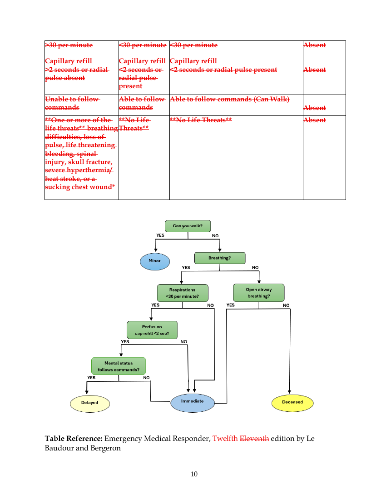

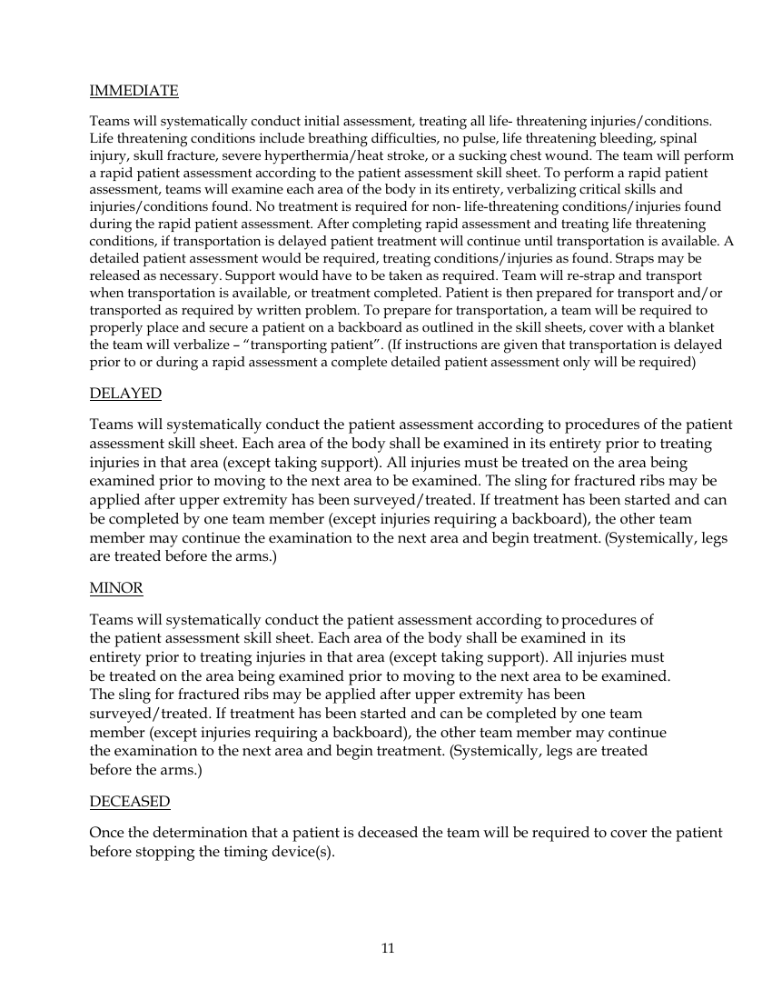

**1. IMMEDIATE**

Teams will systematically conduct initial assessment, treating all life- threatening injuries/conditions. Life threatening conditions include breathing difficulties, no pulse, life threatening bleeding, spinal injury, skull fracture, severe hyperthermia/heat stroke, or a sucking chest wound. The team will perform a rapid patient assessment according to the patient assessment skill sheet. To perform a rapid patient assessment, teams will examine each area of the body in its entirety, verbalizing critical skills and injuries/conditions found. No treatment is required for non- life-threatening conditions/injuries found during the rapid patient assessment. After completing rapid assessment and treating life threatening conditions, if transportation is delayed patient treatment will continue until transportation is available. A detailed patient assessment would be required, treating conditions/injuries as found. Straps may be released as necessary. Support would have to be taken as required. Team will re-strap and transport when transportation is available, or treatment completed. Patient is then prepared for transport and/or transported as required by written problem. To prepare for transportation, a team will be required to properly place and secure a patient on a backboard as outlined in the skill sheets, cover with a blanket the team will verbalize – “transporting patient”. (If instructions are given that transportation is delayed prior to or during a rapid assessment a complete detailed patient assessment only will be required)

**2. DELAYED**

Teams will systematically conduct the patient assessment according to procedures of the patient assessment skill sheet. Each area of the body shall be examined in its entirety prior to treating injuries in that area (except taking support). All injuries must be treated on the area being examined prior to moving to the next area to be examined. The sling for fractured ribs may be applied after upper extremity has been surveyed/treated. If treatment has been started and can be completed by one team member (except injuries requiring a backboard), the other team member may continue the examination to the next area and begin treatment. (Systemically, legs are treated before the arms.)

**3. MINOR**

Teams will systematically conduct the patient assessment according to procedures of the patient assessment skill sheet. Each area of the body shall be examined in its entirety prior to treating injuries in that area (except taking support). All injuries must be treated on the area being examined prior to moving to the next area to be examined. The sling for fractured ribs may be applied after upper extremity has been surveyed/treated. If treatment has been started and can be completed by one team member (except injuries requiring a backboard), the other team member may continue the examination to the next area and begin treatment. (Systemically, legs are treated before the arms.)

**4. DECEASED**

Once the determination that a patient is deceased the team will be required to cover the patient before stopping the timing device(s).


## Scorecard A Discounts  
*Rulebook pages 12–15*

**1.** All life-threatening conditions shall be located and started before patient assessment can begin. ___20

Life threatening conditions will be considered a patient having any one or more of the following conditions: breathing difficulties, no pulse, life threatening bleeding, spinal injury, skull fracture, severe hyperthermia/heat stroke, or a sucking chest wound.

Patient assessment can begin after all life-threatening conditions have been located and treatment started. Environmental and Medical Emergencies can be treated anytime during the working of the problem after initial assessment.

**2.** When the team encounters life-threatening bleeding, no work other than controlling bleeding shall be done until bleeding is controlled. Bleeding is controlled when notified by the Judge (judge makes a statement that bleeding is controlled). If treatment has been started and one team member can complete that treatment, the other team member may continue to work. ___10 each infraction

**3.** During the course of the problem, teams may encounter a card, envelope or label stating various conditions. Upon completion of treatment of these conditions, resume patient assessment at the point where team left off. ___5 each infraction.

**4.** Patient cannot talk, direct, or assist unless stated in the problem. (Reactionary or unintentional movements by the patient should not be discounted) ___5 each infraction

**5.** The bystander/patient if used as a bystander must be shown the correct method of support. ___2

The bystander must be shown the correct method of support and maintaining the open airway by a team member or members any time during the working of the problem, but before taking support.

**6.** No practicing will be allowed on the field before the beginning of the contest. No reference books or training material will be permitted in the working area during the working or reading of the problems. ___5

NOTE: Teams will only be afforded the opportunity to practice on the provided manikin for a maximum of 5 minutes on designated First-Aid Field prior to working the problem.

**7.** All team members shall be dressed uniformly. Shoes need not be identical. The pants/shorts shall be the same color. The contest director may have different requirements. ___1

**8.** The team’s material and equipment (jump kits, aprons, vests, splints, etc.) may not be assembled or donned (excluding BSI) until after the timing device is started. The manikin may be placed in the designated area prior to starting the timing device. ___5

**9.** Handling of a patient by a team or team member in such a manner that could compromise condition of the patient. (Examples: Mishandling extremities, stepping across patient, etc.) (Straddling is only acceptable for patient loading.) (This does not include the rolling of the patient to the side that is injured or rolling a patient more than one time that has signs/symptoms of spinal injury. When teams are required to roll a patient with signs/symptoms of spinal injury, the correct log roll procedure skill sheet for the selected log roll technique, whether it is two- or three-person log roll will be followed). ___5 each infraction

**10.** All injuries and/or conditions shall be treated (example: wound, fracture, frostbite). ___20 each infraction

**11.** Failure to perform a required critical skill. Each CRITICAL SKILL shall be performed as identified on the skill sheets. ___2 each infraction (except for CPR/AV covered by scorecard B)

**12.** During patient assessment, failure to verbally state the location physically examined and each condition found. ___1 each infraction.

**13.** Working out of order (assessment, procedure, critical skill). ___2

**14.** Failure to follow written instructions. ___5

**15.** Teams shall not pad around the head and neck of the patient, for a suspected spinal injury, before the patient is placed onto the backboard. ___1

**16.** Protective equipment must be donned prior to patient(s) contact (gloves and eye protection). Only BSI may be donned prior to starting the timing device. ___5 each infraction

**17.** Gloves shall be changed because of a glove tear or prior to contacting a different patient. ___2 each infraction

**18.** The back board may be preassembled and padded. Other splints may be pre-padded but not assembled. (Cravat bandages cannot be preassembled on the back board, except for tying padding). ___5 each infraction

**19.** Failure to take support of a fracture or dislocation (not supporting fracture or dislocation). ___10 each infraction

A. Support of Extremities – Above and below the fracture or dislocation

B. Support of Hip – Both sides of the fracture or dislocation

C. Support for spinal injury – Stabilization of neck/Modified Jaw Thrust except for analyzing and shocking with AED patient during CPR

D. Support for skull fracture – Stabilization of neck/Modified Jaw Thrust

E. No support for fractured ribs,

F. No support of fractures/dislocations of nose, jaw, fingers, and toes

**20.** Support of fractures and/or dislocations shall not be broken or released. (except during the use of an AED when analyzing or shock is delivered) ___5 each infraction When changing support, if support is broken, this discount applies. Change of support can be done as many times as the team desires provided the support is not broken.

Support for upper extremity fractures/dislocations shall be maintained until the sling and swathe are completed. Discount if support of fracture and/or dislocation is released by support person before sling is completed. Sling and swath not required with air splints.

**21.** Fractures/dislocations shall be supported prior to bandaging injuries. Once the extremity has been assessed, fractures/dislocations must be supported prior to bandaging injuries on the extremity. Each area of the body shall be examined in its entirety prior to treating injuries in that area (except taking support). ___5 each infraction During initial and patient assessment, teams must physically support/stabilize fractures and dislocations that require support as they are found. When the fracture/dislocation is on an extremity and support has been taken, the team must complete the examination on the extremity treating other injures prior to splinting the fracture/dislocation.

**22.** Not applying sling for upper extremity wound.

A sling and swathe are required for musculoskeletal injuries to the shoulder, upper arm, elbows, lower arm, and wrists. Slings will not be required for upper extremity burns/deep cold injuries. However, if a burn/deep cold injury and musculoskeletal injuries are present on the same upper extremity, a sling shall be applied. ___1 each infraction

**23.** Failure to determine immediate patients. ___10 each infraction An immediate patient shall be transported immediately (if transportation is available). This presents a load and go situation. Once a patient is determined to be an Immediate Patient during Triage or during patient assessment the patient status will always be an immediate patient, unless otherwise notified.

Immediate conditions are:

 Respirations: >30 respirations per minute  Perfusion: Capillary refill > 2 seconds or radial pulse absent  Mental Status: Unable to follow commands. Any one or more of the above conditions must be clearly visible on the patients.

**24.** Failure of team to start/stop timing device ___2 discount

**25.** Each incorrect answer on written examination ___1 discount

**26.** Failure to comply with other written adopted National Rules not covered in Discount Sheets, ___2 each infraction

**27.** A team member who performs an act(s) that will endanger self, another team member, or patient, regarding scene safety___5 each infraction per person (15 maximum per infraction)

NOTE: If the intent of the problem is to identify potential unsafe conditions this should be clearly identified in the written statement and on placard(s) at the scene.


## Interpretations of Scorecard B – Artificial Ventilation/Cardiopulmonary Resuscitation  
*Rulebook pages 16–16*

**1.** Failure to determine unresponsiveness (according to Critical Skill Sheet). ___1

**2.** Failure to call for help. ___1

**3.** Failure to open airway. ___1

**4.** Failure to use proper maneuver to open airway (using head-tilt/chin-lift maneuver when jaw-thrust should be used, vice versa). ___1

**5.** Failure to assess breathlessness within 10 seconds. ___1

**6.** Failure to use one-way valve barrier device when ventilating manikin. ___1

**7.** Failure to state “get AED”. ___1

**8.** Failure to use mouth-to-nose ventilation when required. ___1

**9.** Failure to keep body and head in line if spinal injury exists. ___1

**10.** Failure to use tongue jaw lift, cross-finger technique, or finger sweep when required. ___1

**11.** Failure to reposition head when airway obstruction is suspected. ___1

**12.** Failure to give chest compressions when required. ___1 (airway obstruction skill sheet)

**13.** Failure to make pulse prior to giving compressions. ___1

**14.** Failure to assess pulse for 5-10 seconds. ___1

**15.** Failure to correctly locate the carotid pulse. ___1

**16.** Failure to ask judge for presence of a pulse. ___ 1


## Interpretations of Scorecard B – Cardiopulmonary Resuscitation  
*Rulebook pages 17–18*

**1.** Failure to give AV/CPR when required. ___20 (Maximum of 3 sets AV/CPR or combination thereof)

**2.** Improper Hand placement when giving compressions. ___1

**3.** Failure to make parallel axis with heels of hands. ___1

**4.** Allowing fingers to rest on chest. ___1

**5.** Compressions. Discounts shall apply to each.cycle

A. Depth. Compression depth shall be at least 2 inches. Over compressions shall not be discounted. ___1

B. Number required. A total of 30 compressions shall be made each cycle. ___ 1

C. Release of upstroke. ___1

D. Rate. Compressions shall be made at the rate of 100 to 120 per minute. ___1

**6.** Failure to maintain hand contact with manikin when releasing pressure during compressions. ___1 (This does not apply between cycles).

**7.** Failure to give 2 breaths between each cycle of compressions. ___1

A. Timing (not completing breaths and returning to compressions in less than 10 seconds (This will be measured from the end of last down stroke to the start of the first down stroke of the next cycle). ___1

B. Volume shall be at least.8 liters (through.7-liter line on new manikins). Over inflation shall not be discounted. ___1

**8.** Failure to give 5 cycles of 30 compressions and 2 breaths for each set of CPR (point of first down stroke to peak of last breath). (A cycle is 30 compressions and two (2) ventilations. A set is 5 cycles). ___ 5

**9.** Failure to assess pulse within 10 seconds after each set of CPR. ___1 (one discount per set)

**10.** Failure to give 30 chest compressions when airway obstruction is suspected. ___1

**11.** Failure to perform CPR as stated in the problem. ___ 20

**12.** Failure for the number of Rescuer/Rescuers to perform CPR as stated in the problem. Team performing One-Person CPR when Two-Person CPR is required and vice versa. (When problem states “Two-Rescuer CPR”, two people are required to perform CPR as listed in Two-Rescuer CPR skill sheets). ___3

**13.** Failure to begin with compressions after pulse check is completed or when changing rescuers. ___1

**14.** Failure to apply the AED when available. ___10

**15.** Failure of rescuers to change positions in 5 seconds or less when performing two- person CPR. ___1

**16.** Failure of rescuer to ask the judge if the patient has a pulse when CPR is completed. ___1

**17.** Delivery of simulated shock with AED to patient while in contact with the patient ___5 each occurrence (add to scorecard)


## Interpretations of Scorecard B – Artificial Ventilation  
*Rulebook pages 18–18*

**1.** Failure to give artificial ventilation. (Maximum of 3 sets AV/CPR or combination thereof) ___20

**2.** Failure to give a breath about every 6 seconds, totaling 10 breaths per minute.

. (1 minute of AV = 1 set) ___1

**3.** Failure to provide a breath volume of at least.8 liters. Over inflation shall not be discounted. ___1

**4.** Failure of rescuer to check for return of breathing and pulse when artificial ventilation is completed. ___1


## Skill Sheets (Procedures and Critical Skills)  
*Rulebook pages 19–58*

*NOTE: Each critical skill identified with an asterisk (*) shall be clearly verbalized by the team as it is being conducted at contest not utilizing moulage or a combination of moulage/stickers. Each critical skill identified with a double asterisk (**) shall be clearly verbalized by the team as it is being conducted at all contests. After initially stating what BP-DOC- Bleeding, Pain, Deformities, Open Wounds, Crepitus stands for, the team may simply state BP-DOC when making their checks. Teams my use the acronym “CSM” after first stating what CSM means, circulation, sensation, and motor function, when checking.

> Skill sheets are two-column tables (procedure | critical skills, with □ check boxes; * = verbalize when not using moulage, ** = verbalize at all contests). Text is kept line-by-line as printed (format "pre"); each sheet also has page images. The 2026 redline deleted the "Two-Rescuer CPR with AED (With Spinal Injury – Manikin Only)" sheet entirely (PDF pp. 29–31 are struck through), even though the index still lists it.


**1. Initial Assessment**

```
    PROCEDURES    CRITICAL SKILLS
                           □    **A. Observe area to ensure safety
   1. SCENE SIZE UP
                           □    **B. Call for help
                           □    **A. Determine causes of injury, if possible
   2. MECHANISM    □    **B. Triage: Immediate, Delayed, Minor or Deceased.
     OF INJURY    **C. Ask patient (if conscious) what happened
                           □
                           □    **A. Verbalize general impression of the patient(s)
                           □    **B. Determine responsiveness/level of
   3. INITIAL
                                    consciousness (AVPU) Alert, Verbal, Painful,
     ASSESSMENT
                                    Unresponsive
                           □    **C. Determine chief complaint/apparent life threat
                           □    A. Correctly execute head-tilt/chin-lift or jaw thrust
                                    maneuver, depending on the presence of cervical
                                    spine (neck) injuries
   4. ASSESS AIRWAY    □
                                B. Look for absence of breathing (no chest rise and
     AND BREATHING
                                    fall) or gasping, which are not considered
                                    adequate (within 10 seconds)
                           □    C. If present, treat sucking chest wound
                           □    A. Check for presence of a carotid pulse (5-10
                                    seconds
   5. ASSESS FOR
                           □    B. If present, control life threatening bleeding
     CIRCULATION
                           □    C. Start treatment for all other life-threatening
                                    injuries/conditions
IMMEDIATE: Rapid Patient Assessment treating all life threats Load and Go. If the treatment
interrupts the rapid trauma assessment, the assessment will be completed at the end of the
treatment.
DELAYED: Detailed Patient Assessment treating all injuries and conditions and prepare for
transport.
MINOR: (Can Walk) Detailed Patient Assessment treating all injuries and conditions and
prepare for transport. After all IMMEDIATE and DELAYED patient(s) have been treated and
transported.
DECEASED: Cover
```

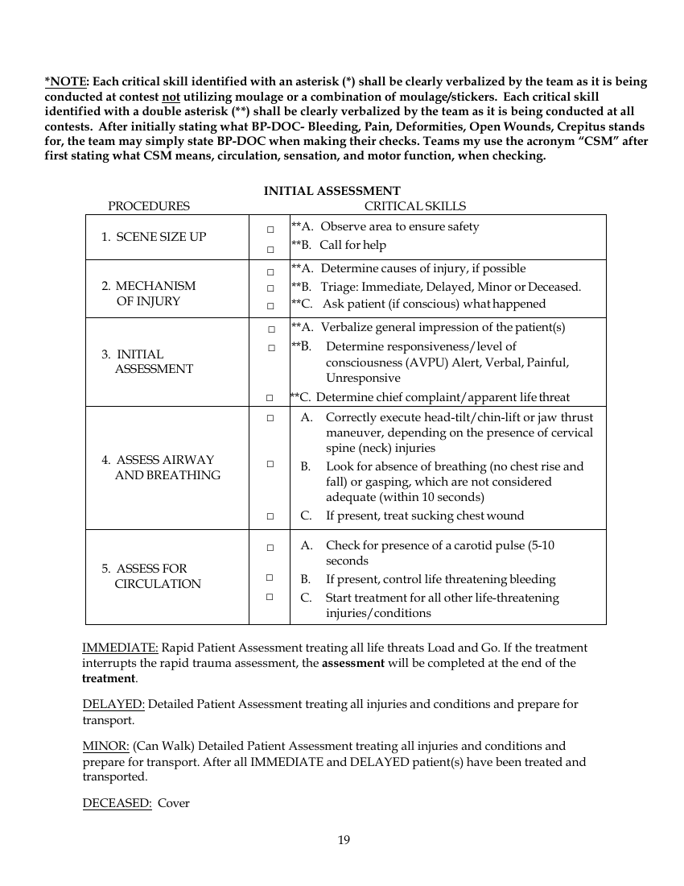


**2. Patient Assessment**

```
PROCEDURES    CRITICAL SKILLS
                      □    **A. Check head for BP-DOC: Bleeding, Pain, Deformities,
                                Open wounds, Crepitus
                      □
                           **B. Check and touch the scalp
                      □    **C.
                                Check the face
                      □    **D. Check the ears for bleeding or clear fluids
  1. HEAD
                      □    **E. Check the eyes for any discoloration, unequal pupils,
                                reaction to light, foreign objects and bleeding
                      □
                           **F. Check the nose for any bleeding or drainage
                      □    **G. Check the mouth for loose or broken teeth,
                                foreign objects, swelling or injury of tongue,
                                unusual breath odor and discoloration
                      □    **A. Check the neck
  2. NECK
                      □    **B.    Inspect for medical ID
                      □    **A. Check chest area
                      □    **B. Feel chest for equal breathing movement on both sides
  3. CHEST
                      □    **C. Feel chest for inward movement in the rib areas
                                during inhalations
  4. ABDOMEN    □    **A. Check abdomen (stomach)
                      □    **A. Check pelvis Inspect pelvis for injury by touch
  5. PELVIS    □    (Visually inspect and verbally state inspection of crotch
                           **B.
                                 and buttocks areas)
                   L    R
                   □    □ **A. Check each leg
                   □    □    B. Inspect legs for injury by touch
                   □    □    C. Unresponsive: Check legs for paralysis (pinch inner
  6. LEGS    side of leg on calf)
                   □    □
                           **D. Responsive: Check legs for motion; places hand on
                                bottom of each foot and states “Can you push against
                                my hand?”
                   □    □
                           **E. Check for medical ID bracelet
                   L    R
                   □    □ **A. Check each arm
                   □    □    B. Inspect arms for injury by touch
                   □    □    C. Unresponsive: Check arms for paralysis (pinch inner
  7. ARMS    side of wrist)
                   □    □ **D. Responsive: Check arms for motion (in a conscious
                                patient; team places fingers in each hand of patient
                                and states “Can you squeeze my fingers?”
                   □    □
                           **E. Check for medical ID bracelet
 8. BACK
                          □    **A. Check back
  SURFACES
```

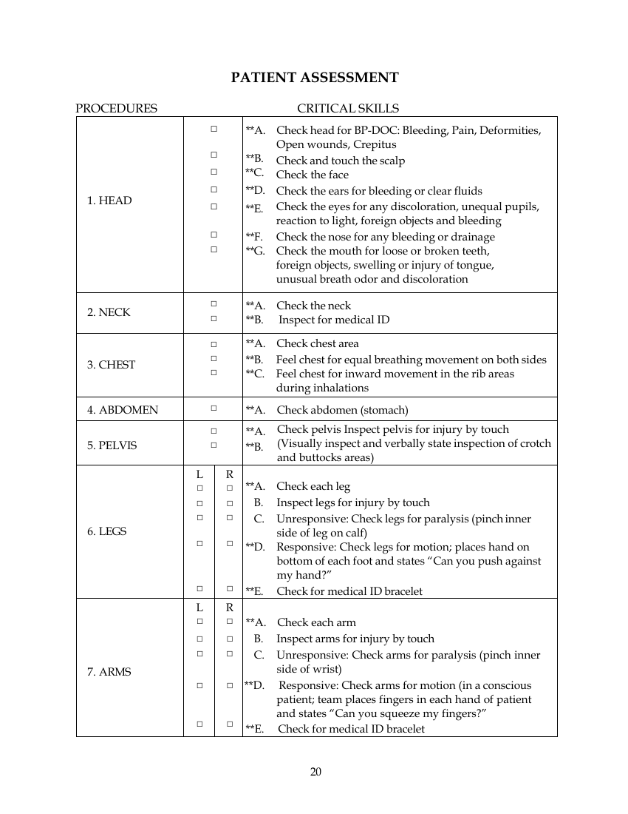


**3. One-Person CPR (Manikin Only)**

```
   PROCEDURES    CRITICAL SKILLS
                         □    A.    Tap or gently shake shoulders
                         □ **B.    “Are you OK?”
1. RESCUER ESTABLISH    □    C.    Determine unconsciousness without compromising
  UNRESPONSIVENESS    cervical spine (neck) injury
                         □ **D. “Call for help”
                         □ **E.    “Get AED” (Note: If AED is used, follow local
                                  protocol)
                         □
2. RESCUER MONITOR    A. Look for absence of breathing (no chest rise and fall)
  PATIENT FOR    or gasping breaths, which are not considered
  BREATHING    adequate (within 10 seconds)
                         □    A. Correctly locate the carotid pulse - on the side of
                                  the rescuer, locate the patient’s windpipe with
                                  your index and middle fingers and slide your
                                  fingers in the groove between the windpipe and
3. RESCUER CHECK FOR
                                  the muscle in the neck
  CAROTID PULSE
                          □
                              B.    Check for presence of carotid pulse for 5 to 10
                                  Seconds
                         □
                             **C.    Absence of pulse
                         □    D. Immediately start CPR if no pulse
                         □    A. Locate the compression point on the breastbone
                                  between the nipples
                         □    B.    Place the heel of one hand on the compression
4. POSITION FOR    point and the other hand on top of the first so
  COMPRESSIONS    hands are parallel
                         □
                              C. Do not intentionally rest fingers on the chest
                         □    D.    Keep heel of your hand on chest during and between
                                  compressions
                         □    A. Give 30 compressions
                         □
                              B.    Compressions are at the rate of 100-120 per minute
5. DELIVER CARDIAC
                         □
  COMPRESSION    C. Down stroke for compression must be on or
                                  through compression line
                         □
                              D. Return to baseline on upstroke of compression
                         □    A. Kneel at the patient’s side near the head
                         □    B. Correctly execute head-tilt/ chin-lift or jaw thrust
6. ESTABLISH AIRWAY
                                  maneuver depending on the presence of cervical
                                  spine injuries
                         □    A. Place barrier device (pocket mask / shield with one
                                  way valve) on manikin
                         □    B. Give 2 breaths 1 second each
7. VENTILATIONS    □    C. Each breath - minimum of .8 (through .7-liter line
   BETWEEN    on new manikins)
   COMPRESSIONS    □
                              D. Complete breaths and return to compressions in
                                  less than 10 seconds (This will be measured from
                                  the end of last down stroke to the start of the first
                                  down stroke of the next cycle.)
                         □
                              A. Provide 5 cycles of 30 chest compressions and 2
                                 rescue breaths
                         □    B. To check for pulse, stop chest compressions for no
                                 more than 10 seconds after the first set of CPR
                         □    C. Rescuer opens airway and checks for adequate
                                 breathing or coughing
8. CONTINUE CPR FOR    □
                              D. Rescuer checks for a carotid pulse
  TIME STATED IN
                         □    E. If no signs of circulation are detected, continue
  PROBLEM
                                 chest compressions and breaths and check for signs
                                 of circulation after each set
                         □    F. A maximum of 10 seconds will be allowed to
                                 complete ventilations and required pulse checks
                                 between sets (this will be measured from the end of
                                 the last down stroke to the start of the first down
                                 stroke of the next cycle)
                         □    A. After providing required CPR (outlined in problem),
9. CHECK FOR
                                 check for return of pulse (within 10 seconds)
  RETURN OF PULSE
                         □
                             **B. “Ask judge for presence of a pulse.”
```

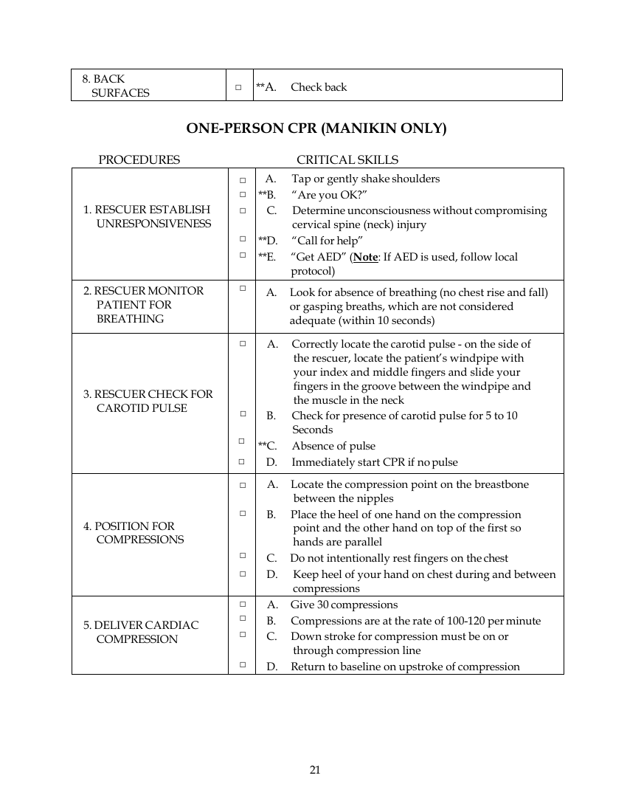

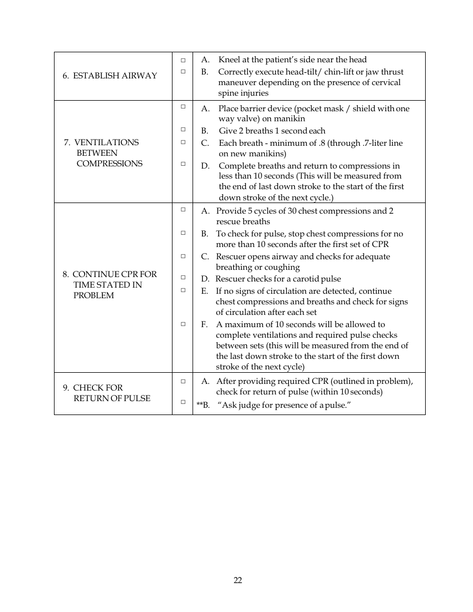


**4. Two-Rescuer CPR with AED (Manikin Only)**

```
       PROCEDURES    CRITICAL SKILLS
                             □    A.    Tap or gently shake shoulders
                             □
                                **B.    “Are you OK?”
 1. RESCUER ESTABLISH    □    C.    Determine unconsciousness without compromising
   UNRESPONSIVENESS    cervical spine (neck) injury
                             □ **D. “Call for help”
                             □
                                **E.    “Get AED” (Note: If AED is used, follow local
                                      protocol)
 2. RESCUER MONITOR    □    A.    Look for absence of breathing (no chest rise and fall)
    PATIENT FOR    or gasping breaths, which are not considered
    BREATHING    adequate (within 10 seconds)
                             □    A. Correctly locate the carotid pulse - on the side of the
                                     rescuer, locate the patient’s windpipe with your
                                     index and middle fingers and slide your fingers in
                                     the groove between the windpipe and the muscle in
 3. RESCUER CHECK
                                     the neck
   FOR CAROTID PULSE
                             □    B.    Check for presence of carotid pulse for 5 to
                                      10 Seconds
                             □
                                **C.    Absence of pulse
                             □
                                 D. Immediately starts CPR if no pulse
                             □    A. Locate the compression point on the breastbone
                                     between the nipples
                             □    B. Place the heel of one hand on the compression point
 4. RESCUER
                                     and the other hand on top of the first so hands are
   POSITION FOR
                                     parallel.
   COMPRESSIONS
                             □
                                  C. Do not intentionally rest fingers on the chest. Keep
                                     heel of your hand on chest during and between
                                     compressions.
                             □    A. After compressions have
 5. RESCUER DELIVER    started, the AED must be applied. Compressions
  CARDIAC    are to be delivered as follows:
  COMPRESSION / AED    ✓ At the rate of 100 to 120 per minute;
  APPLICATION    ✓ Down stroke must be on or through compression
                                      line; and
                                     ✓ Return to baseline on upstroke of compression.
                             □    B. R escuers clear victim,
                                     allowing AED to analyze. (Judges will verbalize
                                                                   a shockable
                                     or non-shockable rhythm)
                             □
                                 C. If AED indicates a shockable rhythm, rescuer
                                     clears victim again and delivers shock.
                                     *verbalize shock given
                             □    A. Rescuer gives 30 compressions immediately
 6. BEGIN HIGH QUALITY
   CPR    after shock delivery .
                             □    B. After 30 compressions, the other rescuer successfully
                                     delivers 2 breaths, as per skills 7 & 8 below.
 7. RESCUER ESTABLISH    □    A. Kneel at the patient’s side near the head
   AIRWAY    □    B. Correctly open the airway, according to the injury.
                             □    A. Place barrier device (pocket mask/shield with one
                                     way valve) on manikin
                             □    B. Give 2 breaths 1 second each
 8. RESCUER VENTILATIONS
                             □    C. Each breath - minimum of .8 (through .7-liter line
   BETWEEN COMPRESSIONS
                                     on new manikins)
                             □    D. Complete breaths and return to compressions in less
                                     than 10 seconds (This will be measured from the end
                                     of last down stroke to the start of the first down stroke
                                     of the next cycle.)
                             □    A. Provide 5 cycles of 30 chest compressions and 2 rescue
                                      breaths
                             □    B. To check for pulse, stop chest compressions for
                                      no more than 10 seconds after the first set of CPR
                             □    C. Rescuer at patient’s head maintains airway and
                                      checks for adequate breathing or coughing
                             □    D. The rescuer at the patient’s head shall feel for a
 9. CONTINUE CPR FOR TIME
    STATED IN PROBLEM    carotid pulse
                             □    E. If no signs of circulation are detected, continue
                                      chest compressions and breaths and check for signs
                                      of circulation after each set
                             □
                                  F.    A maximum of 10 seconds will be allowed to
                                      complete ventilations and required pulse checks
                                      between sets (this will be measured from the end of
                                      the last down stroke to the start of the first down
                                      stroke of the next cycle
                             □    A. Change of rescuers shall be made in 5 seconds or less
10. CHANGING RESCUERS    and will be completed as outlined in the problem.
                                     Team must switch every 5 cycles in less than 5
                                     seconds
                             □    A. After providing required CPR (outlined in problem),
11. CHECK FOR RETURN OF
                                     check for return of pulse (within 10 seconds)
    PULSE    □
                                 **B. “Ask judge for presence of a pulse.”
```

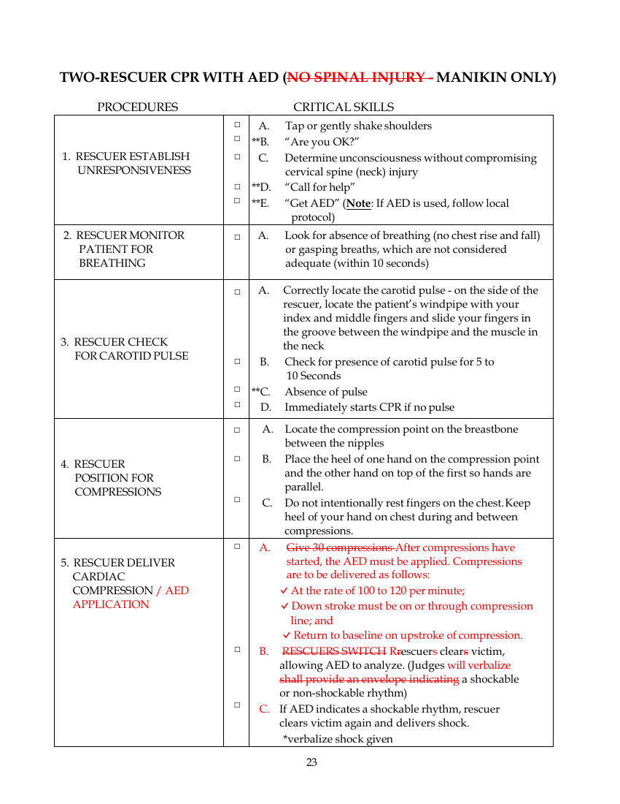

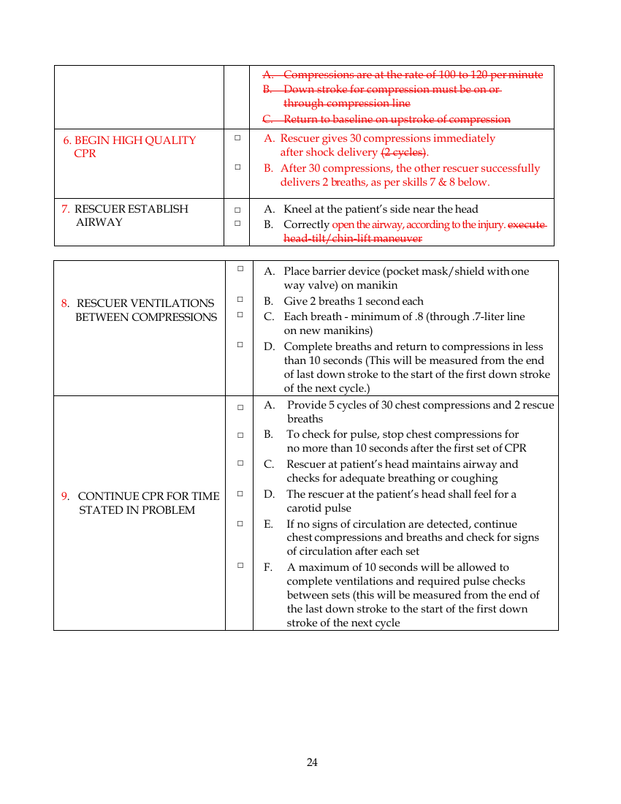

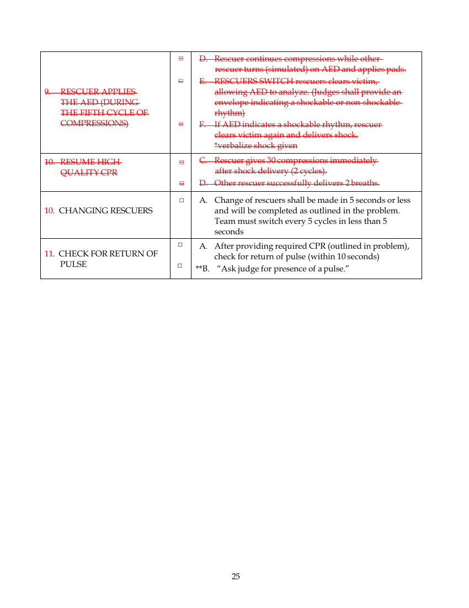


**5. Mouth-To-Mask Resuscitation**

```
   PROCEDURES    CRITICAL SKILLS
                           □    A. Tap or gently shake shoulders
                           □    **B.    “Are you OK?”
                           □    C.    Determine unconsciousness without
1. ESTABLISH
                                   compromising C-spine injury
  UNRESPONSIVENESS
                           □
                              **D. “Call for help”
                          □
                              **E. “Get AED” (Note: If AED is used, follow local
                                   protocol)
                           □    A. Look for absence of breathing (no chest rise and
2. MONITOR
                                   fall) or gasping, which are not considered adequate
  PATIENT FOR
                                   (within 10 seconds)
  BREATHING
                           □    A. Correctly locate the carotid pulse (on the side
                                   of the rescuer)
3. CHECK FOR    □    B. Check for presence of carotid pulse for 5 to 10
  CAROTID PULSE    seconds.
                           □
                              **C. Presence of pulse
                          □    A. Correctly execute head tilt / chin lift or jaw thrust
4. ESTABLISH AIRWAY    maneuver depending on the presence of cervical
                                   spine (neck) injuries
                           □    A. Place barrier device (pocket mask/shield with one-
                                   way valve on manikin
5. VENTILATE PATIENT    □
                               B. Ventilate patient 10 times per minute. Each
                                   ventilation will be provided at a minimum of .8
                                   liter
                           □    A. After providing the required number of breaths
6. CHECK FOR RETURN
                                   (outlined in problem), check for return of
 OF BREATHING AND
                                   breathing and carotid pulse within 10 seconds
 PULSE
                           □
                               **B. “Patient is breathing and has a pulse”
```

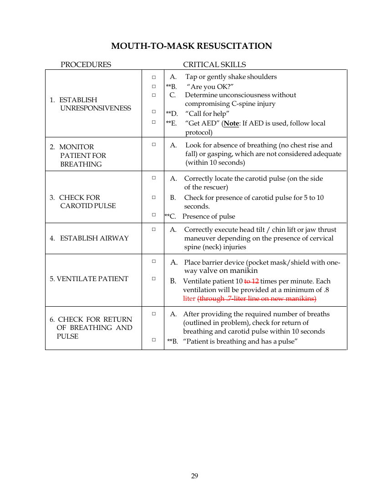


**6. Airway Obstruction (Unconscious Victim – Witnessed)**

```
   PROCEDURES    CRITICAL SKILLS
                           □    A. Tap or gently shake shoulders
                           □    **B. “Are you OK?”
 1. INITIALLY ASSESS    □
                                C. Determine unconsciousness without
    LEVEL OF
                                   compromising C-spin injury
    CONSCIOUSNESS    □
                               **D. “Call for help”
                           □
                               **E. “Get AED” (Note: If AED is used, follow local
                                   protocol)
 2. MONITOR    □    A. Look for absence of breathing (no chest rise and fall)
    PATIENT FOR    or gasping, which are not considered adequate
    BREATHING    (within 10 seconds)
                           □    A. Correctly locate the carotid pulse - on the side of the
                                   rescuer, locate the patient’s windpipe with your
                                   index and middle fingers and slide your fingers in
                                   the groove between the windpipe and muscle in the
 3. PULSE CHECK    neck
                           □
                                B. Check for presence of carotid pulse for 5 to
                                   10 seconds
                           □
                               **C. Patient has pulse
                           □    A. Correctly execute head-tilt/chin-lift or jaw thrust
                                   maneuver depending on the presence of cervical
 4. OPEN AIRWAY
                                   spine (neck) injuries
                           □    **B. “Look for foreign object”
                           □    A. Place barrier device on manikin
 5. ATTEMPT    □    B. Seal mouth and nose
    VENTILATION    □
                                C. Attempt to give slow breath (1 second duration)
                           □
                               **D. Identify if there is an obstruction
                           □    A. Re-establish airway using correct method and
 6. CHECK POSITIONING    procedure
                           □    **B. Identify continued presence of the obstruction
                           □    A. Locate the compression point on the
                                   breastbone between the nipples
                           □    B. Place the heel of one hand on sternum the
 7. POSITION FOR
                                   compression point and the other hand on top
    COMPRESSIONS
                                   of the first so hands are parallel
                           □    C. Do not rest fingers on the chest keep heel of your
                                   hand on chest during and between
                                   compressions.
                            □    A. Give 30 compressions
                            □    B. Compressions are at the rate of 100-120 per minute
                            □    C. Down stroke for compression must be on
 8. COMPRESSIONS
                                   or through compression line
                            □    D. Return to baseline on upstroke of
                                   compression
                            □    A. Correctly execute head-tilt / chin-lift or jaw-
                                   thrust maneuver depending on the presence of
 9. OPEN AIRWAY
                                   cervical spine (neck) injuries
                            □    **B. “Look for foreign object”
                            □    A. Follow with finger sweep, only if the object is seen.
                                   (open mouth, grasping tongue and lower jaw with
10. PERFORM
                                   thumb and fingers, insert index finger of other
   FINGER SWEEP
                                   hand down along inside cheek and deeply into
    (IF OBJECT IS SEEN)
                                   throat in a hooking action)
                            □
                                B. Grasp and remove foreign object
                            □    A. Correctly make effort to administer breath
                            □    B. Administer second breath, if first successful
 11. ATTEMPT    and check pulse
    VENTILATION    □
                                C. If unsuccessful repeat sequence of compressions,
                                   mouth check, finger sweep (if object is visible)
                                   and attempt to ventilate
```

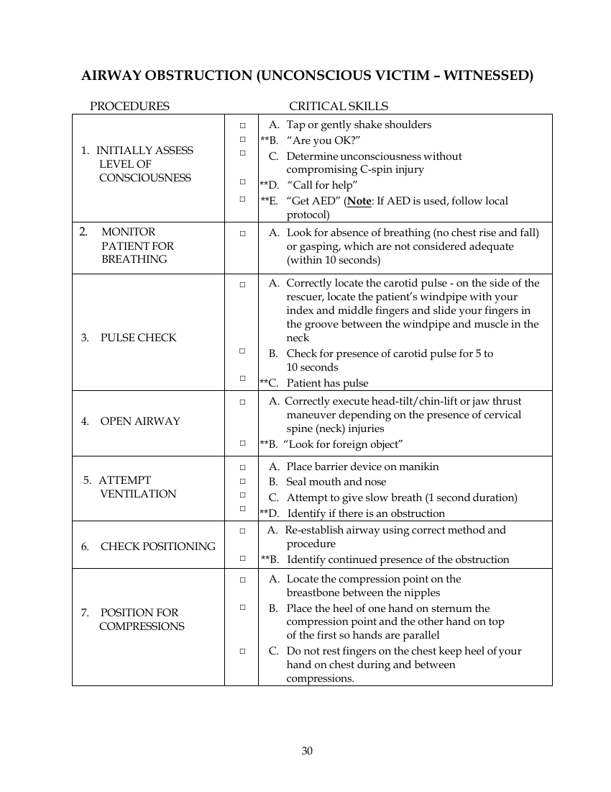

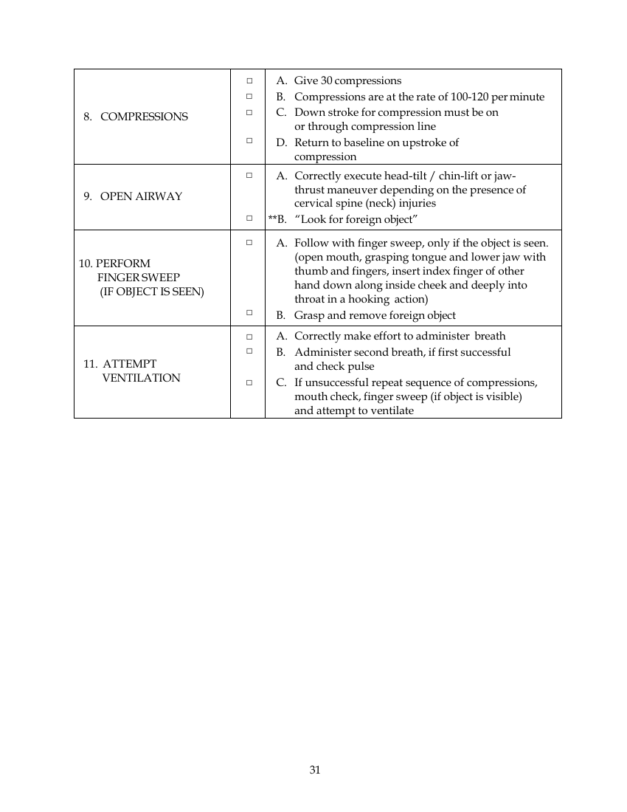


**7. Sucking Chest Wound**

```
  PROCEDURES    CRITICAL SKILLS
1. EXPOSE WOUND    □    *A. Expose entire wound
                         □    *A. Place occlusive dressing over wound (If occlusive
2. SEAL WOUND AND    dressing is not available use gloved hand)
   CONTROL BLEEDING    □    B. Apply direct pressure as needed to stop the
                                 bleeding
                         □
                              C. You must always inspect all sides of torso for
                                 wounds, depending on the Mechanism of Injury (exit
                                 wound(s))
                         □    A. Keep patient calm and quiet
                         □ **B. Explain to the patient what you are doing
                         □    *C. Ensure dressing is large enough not to be
                                 sucked into the wound (two inches beyond
                                 edges of wound)
                         □    D. Affix dressing with tape
3. APPLY AN    □    *E. Seal on three sides
   OCCLUSIVE    □
                             **F. Monitor patient closely for increasing difficulty
   DRESSING    breathing
                         □    G. Transport as soon as possible
                         □    H. Keep patient positioned on the injured side
                                 unless other injuries prohibit
                         □ **I. Reassess wound to ensure bleeding control
                         □
                             **J. Assess level of consciousness (AVPU),
                                 respiratory status and patient response
```

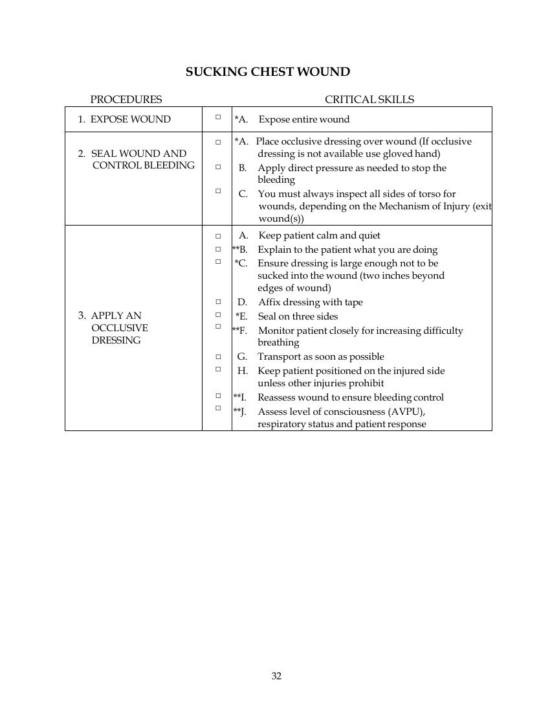


**8. Life-Threatening Bleeding**

```
    PROCEDURES    CRITICAL SKILLS
                           □    *A. Apply direct pressure with a gloved hand (if dressing
                                   is not readily available)
                           □    *B. Apply a dressing to wound (cover entire
 1. DIRECT PRESSURE    wound) and continue to apply direct pressure
   AND ELEVATION    □
                               *C. Elevate the extremity except when spinal
                                   injury exists
                           □ **D. Bleeding has been controlled
                           □    *E. If controlled, bandage dressing in place
 2. IF NOTIFIED THAT
   BLEEDING IS NOT    □    A. Apply as per tourniquet skill sheet
   CONTROLLED, APPLY
   TOURNIQUET
External Bleeding
To Control: 1st: direct pressure
            2nd: elevation & direct pressure
            Last Resort: Tourniquet
Internal Bleeding
**1. Monitor breathing and pulse
**2. Reassure patient and keep calm
**3. Loosen restrictive clothing
**4. Be alert if patient vomits
**5. Nothing by mouth
**6. Report possibility of internal bleeding as soon as EMS personnel arrive on
```

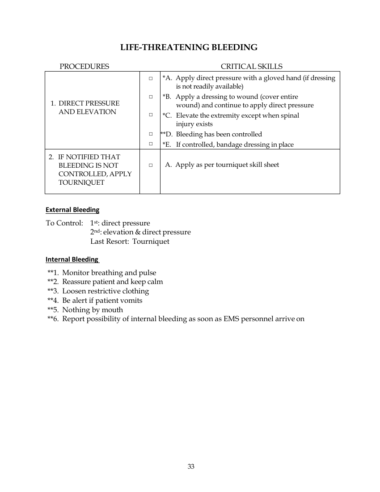


**9. Tourniquet**

```
       PROCEDURES    CRITICAL SKILLS
                                  If these conditions are met, a tourniquet may be
                                  the only alternative:
                             □    A. Direct pressure has not been successful in
1. DETERMINE NEED
                                     stopping bleeding
    OR USING
                             □    B. Elevation of wound above heart has not
    TOURNIQUET
                                     been successful in stopping of bleeding
                             □    A. Select a band that will be between 1-4 inches
 2. SELECT
                                     in width and can be wrapped six or eight
    APPROPRIATE
                                     layers deep for improvised tourniquet or select
    MATERIALS
                                     factory tourniquet.
                                 Factory Tourniquet
                             □    A. Wrap band around the extremity proximal to
                                     the wound (2 – 3 inches above but not on a
                                     joint)
                                 Improvised Tourniquet
 3. APPLY TOURNIQUET
                             □    B. Apply a bandage around the extremity
                                     proximal to the wound (one inch above but
                                     not on a joint) and tie a half knot in the
                                     bandage
                             □    C. Place a stick or pencil on top of the knot and
                                     tie the ends of the bandage over the stick in a
                                     square knot
                             □
                                  D. Twist the stick until the bleeding is
                                     controlled, secure the stick in position
                             □    A. Do not cover the tourniquet with
4. APPLY PRESSURE    bandaging material
    WITH TOURNIQUET    □    **B. Notify other medical personnel caring for the
                                     patient
5. MARK PATIENT    □    A. Record time applied
    APPROPRIATELY
                             □    **A. Assess level of consciousness (AVPU),
 6. REASSESS
                                      respiratory status, and patient
                                      response
```

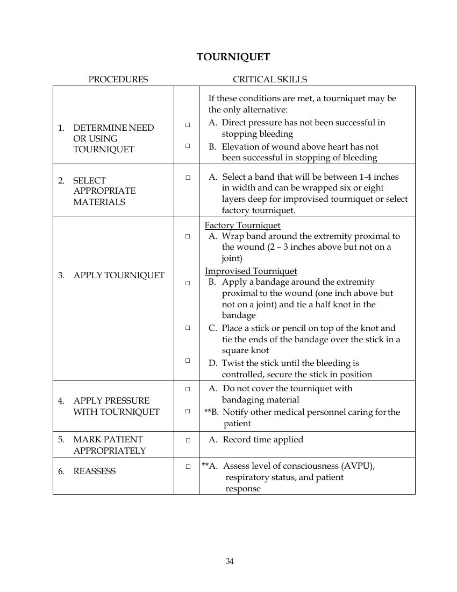


**10. Dressings and Bandaging – Open Wounds**

```
    PROCEDURES    CRITICAL SKILLS
                         □    *A. Control bleeding
1. EMERGENCY CARE    □    *B. Prevent further contamination
  FOR AN OPEN    □    *C. Bandage dressing in place after bleeding has
  WOUND    been controlled
                         □    *D. Keep patient lying still
                         □    A. Use sterile dressing
                         □    B.    Cover entire wound
2. APPLY DRESSING
                         □    C. Control bleeding
                         □
                              D. Do not remove dressing
                         □    A. Do not bandage too tightly.
                         □    B.    Do not bandage too loosely.
3. APPLY BANDAGE    □    C. Cover all edges of dressing.
                         □    D. Do not cover tips of fingers and toes unless
                                  they are injured.
                         □    E.    Bandage from the bottom of the limb to the
                                  top (distal to proximal) if applicable.
 Multiple wounds will be treated as per procedures listed in patient
 assessment.
 Impaled Objects
  *1. Do not remove
  2. Expose wound
  3. Control bleeding
  4. Stabilize with a bulky dressing; crisscross the layers
  5. Secure in place
  *6. Check for exit wound (treat when found)
  7. Immobilize affected area
  Impaled Objects in the Jaw
  *1. Examine; inside & outside
  2. If end not impaled in mouth – pull it out
  3. Position head for drainage: if spinal injury, immobilize 1st and tilt board
  4. Dress outside of wound
 **5. Gauze on inside only if patient alert, (Simulate only in contest and state, “I
     would leave 3-4 inches of gauze outside of mouth.”)
  Impaled Objects in the Eye
  1. Use several layers of dressing or small rolls of gauze to make thick pads. Place them on the
    sides of the object
  2. Put cup (no Styrofoam) over object and allow cup to rest on roller gauze or4x4
  3. Secure cup with roller gauze (not over top of cup)
  *4. Cover uninjured eye too
  Open Neck Wound (Serious or Life Threatening)
  *1. Gloved hand over wound
  *2. Occlusive dressing over wound use tape to seal the dressing on all sides
   3. Gauze dressing over occlusive
   4. Place roller gauze beside site and wrap around figure 8 under opposite arm
  Abdominal Injury
 *1. Place on back with legs flexed at the knees (for closed or open wounds)
 Additional Steps for Open Abdominal Wounds (Serious or Life Threatening)
**1. Apply thick moist dressing, then cover the dressing with plastic.
 *2. Cover the dressing with pads or a towel for warmth
 *3. If an object is impaled in abs, stabilize it and do not flex legs- leave
    them in the position you found them.
  Skull Fractures and Brain Injuries
 *1. Open airway with jaw thrust
  2. Apply collar
 *3. Use loose gauze dressing- no direct pressure
**4. Keep at rest, ask them questions
  5. Don’t elevate legs (on or off a backboard)
  6. After entire body is immobilized- tilt back board, injured side down
  Amputations
**1. Wrap in sterile dressing
  2. Place in plastic bag or wrap in plastic
 *3. Keep part cool avoid freezing
 *4. Do not place in water or direct contact with ice
**5. Transport with patient
  6. Label with patients’ name
  NOTE:
  A sling and swathe are required for musculoskeletal injuries to the shoulder,
  upper arm, elbows, lower arm and wrists. Slings will not be required for upper
  extremity burns/deep cold injuries. However, if a burn/deep cold injury and
  musculoskeletal injuries are present on the same upper extremity, a sling shall be
  applied.
```

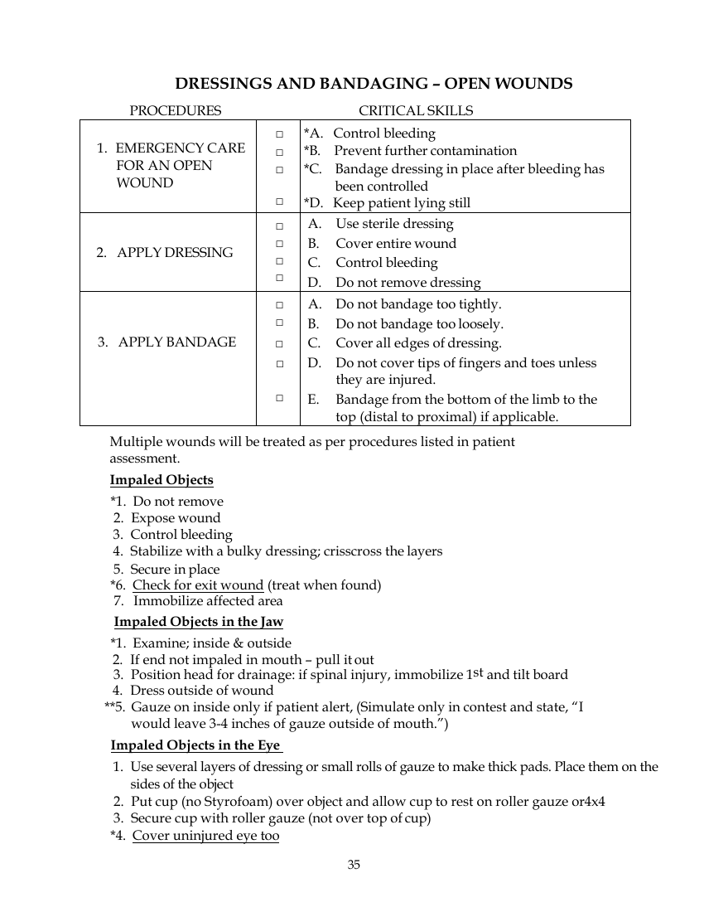

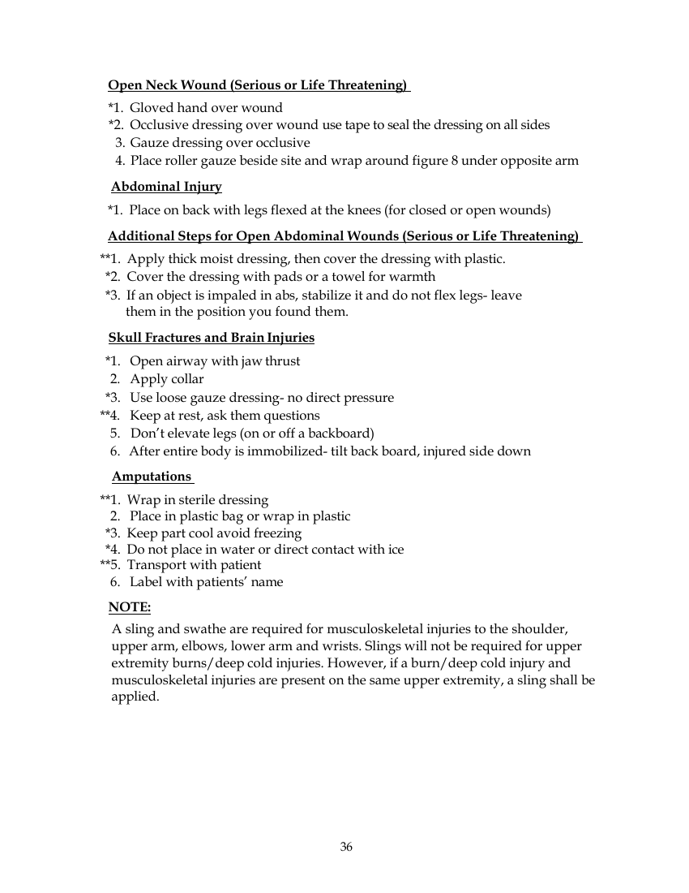


**11. Two-Person Log Roll**

```
        PROCEDURES    CRITICAL SKILLS
1. STABILIZE HEAD    □    *A. Stabilize the head and neck
                                □    A. When placing patient on board place board
                                        parallel to the patient
2. PREPARING THE    □    B. Kneel at the patient’s shoulders opposite the
   PATIENT    board (if used) leaving room to roll the patient
                                        toward knees Raise the patient’s arm, if not
                                        injured (the one closer to the rescuer) above the
                                        patient’s head
3. PREPARING THE    □    A. Grasp the patient at the shoulder and pelvis area
   RESCUER    □    B. Give instructions to bystander, if used to support
                                □    A. While stabilizing the head, roll the patient toward
                                        the rescuer by pulling steadily and evenly at the
                                        shoulder and pelvis areas
                                □
                                     B. The head and neck should remain on the same
4. ROLLING    plane as the torso
   THE PATIENT
                                □    C. Maintain stability by holding patient with
                                        one hand and placing board (if used) with
                                        other
                                □    D. Roll the body as a unit onto the board (if used)
                                        (board may be slanted or flat)
                                □
                                     E. Place the arm alongside the body
```

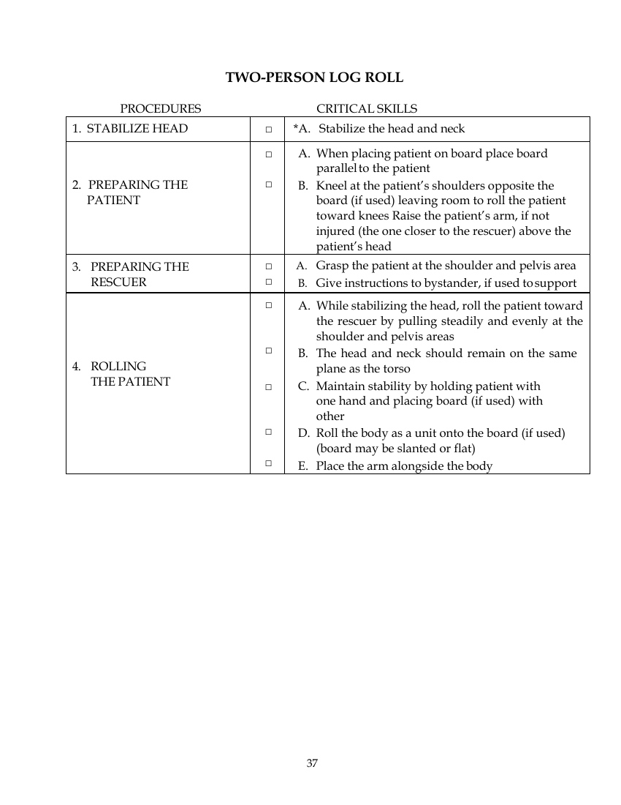


**12. Three-Person Log Roll**

```
        PROCEDURES    CRITICAL SKILLS
                           □    *A. Stabilize the head and neck
                           □
                                B. One rescuer should kneel at the top of the
 1. STABILIZE HEAD
                                   patient’s head and hold or stabilize the head and
                                   neck in position found.
                           □    A. A second rescuer should kneel at the patient’s
                                   side opposite the direction the face is facing.
                           □
                                B. When placing patient on board place board
                                   parallel to the patient.
                           □
 2. PREPARING    C. Quickly assess the patient’s arms to ensure no
    THE PATIENT    obvious injuries.
                           □    D. Kneel at the patient’s shoulders opposite the board (if
                                   used) leaving room to roll the patient toward knees
                                   Raise the patient’s arm, if not injured (the one closer
                                   to the rescuer) above the patient’s head.
                           □    E. The third rescuer should kneel at the patient’s hips.
                           □    A. Rescuers should grasp the patient at the
 3. PREPARING    shoulders, hips, knees, and ankles.
    THE RESCUER    □
                                B. Give instructions to bystander (physically
                                  show), if used to support
                           □    A. While stabilizing the head, the rescuer at the patient’s
                                   head should signal and give directions, all rescuers
                                   should slowly roll the patient toward the rescuers in a
                                   coordinated move, keeping the spine in a neutral, in-
                                   line position.
                           □ **B. On three, slowly roll. One, two, three roll together.
                                   The head and neck should remain on the same plane as
3. ROLLING
                                   the torso, the rescuer holding the head should not
   THE
                                   initially try to turn the head with the body. (if the head
   PATIENT
                                   is already facing sideways, allow the body to come into
                                   alignment with the head)
                           □    C. Maintain stability by holding patient with one hand
                                   and placing board (if used) with other
                           □    D. Roll the body as a unit onto the board (if used) (board
                                   may be slanted or flat) Center the patient on the
                                   board.
                           □    E. Place the arm alongside the body
```

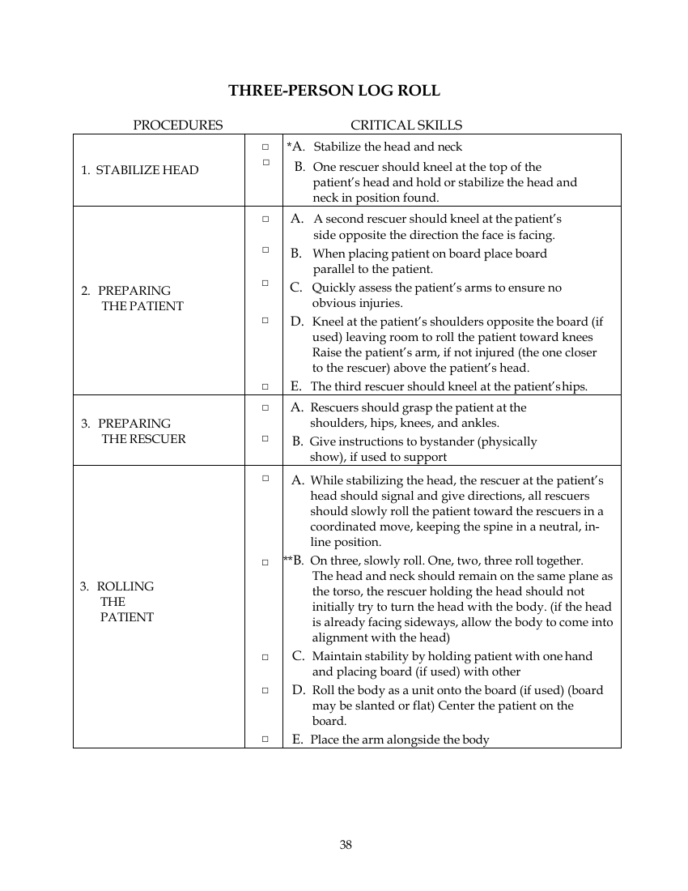


**13. Splinting (Rigid) Upper Extremity Fractures and Dislocations**

```
   PROCEDURES    CRITICAL SKILLS
                            □ **A. Check for distal circulation, sensation,
                                    and motor function
1. CARE FOR FRACTURE
                                     Do not attempt to reduce dislocations (if
                                       applies)
                            □    A. Selection of appropriate rigid splint of proper
                                    length
                            □    B. Support affected limb and limit movement
                            □    C. Apply appropriate padded rigid splint against
                                    injured extremity
2. IMMOBILIZING
                            □    D. Place appropriate roller bandage in hand to
   FRACTURE
                                    ensure the position of function
                            □    E. Secure splint to patient with roller bandage,
                                    handkerchiefs, cravats, or cloth strips
                            □    F. Apply wrap distal to proximal
                            □
                               **G. Reassess distal circulation, sensation, and motor
                                     function
                            □    A. Place sling over chest and under arm
                            □    B. Hold or stabilize arm
                            □    C. Triangle should extend behind elbow on injured
                                    side
3. SECURING WITH    □    D. Pull sling around neck and tie-on uninjured side
   SLING    □    E. Pad at the neck (except when C-Collar is
                                    present)
                            □
                                 F. Secure excess material at elbow
                            □    G. Fingertips should be exposed
                            □
                               **H. Reassess distal circulation, sensation, and motor
                                    function
                            □    A. Use triangle cravat or factory swathe
4. SECURING SLING    □    B. Swathe is tied around chest and injured arm
   WITH SWATHE    □
                               **C. Reassess distal circulation, sensation,
                                    and motor function
ELBOW (STRAIGHT POSITION)
Follow Procedures No. 1 and No. 2 above
FINGER/FINGERS
Immobilize Fracture
1. Tape injured finger to an adjacent uninjured finger; or
2. Tape injured finger to a tongue depressor, aluminum splint, or pen and pencil
3. Secure with sling and swathe
COLLAR BONE
Support and limit movement of affected
area Follow Procedures No. 1, No. 3 and
No. 4 above
SHOULDER BLADE
Support and limit movement of affected
area Follow Procedures No. 1, No. 3 and
No. 4 above
NOTE: Do not reposition dislocations
```

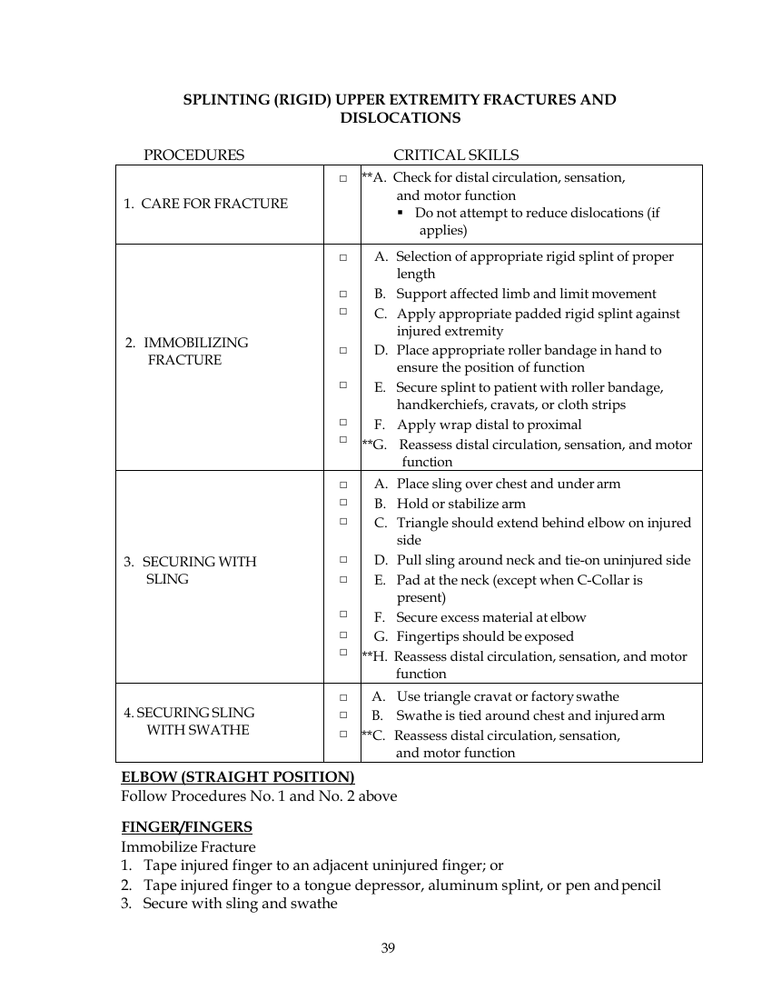


**14. Splinting (Soft) Upper Extremity Fractures and Dislocations (Wrist and Hand)**

```
      PROCEDURES    CRITICAL SKILLS
                             □ **A. Check for distal circulation, sensation, and
                                    motor function
1. CARE FOR FRACTURE
                             □    B. Do not attempt to reduce dislocations (if
                                    applies)
                             □    A. Support affected limb and limit movement
                             □    B. Place two cravats (triangular bandage) under
                                     wrist/hand
2. IMMOBILIZING    □    C. Place pillow length wise under wrist/hand, on
   FRACTURE    top of cravats (pillow should extend past
                                     fingertips)
                             □    D.
                                     Lower limb, adjust cravats to tie
                             □
                                  E. Tie cravats distal to proximal
                             □    A. Place sling over chest and under arm
                             □    B. Hold or stabilize arm
                             □
                                  C. Triangle should extend behind elbow or injured
3. SECURING WITH
                                     side
   SLING
                             □    D. Secure excess material at elbow
                             □    E.
                                     Fingertips should be exposed
                             □
                                **F. Reassess distal circulation, sensation,
                                     and motor function
                             □    A. Use triangle cravat or factory swathe
4. SECURING SLING    □
                                  B. Swathe is tied around chest and injured arm
   WITH SWATHE    □
                                **C. Reassess distal circulation, sensation, and
                                     motor function
```

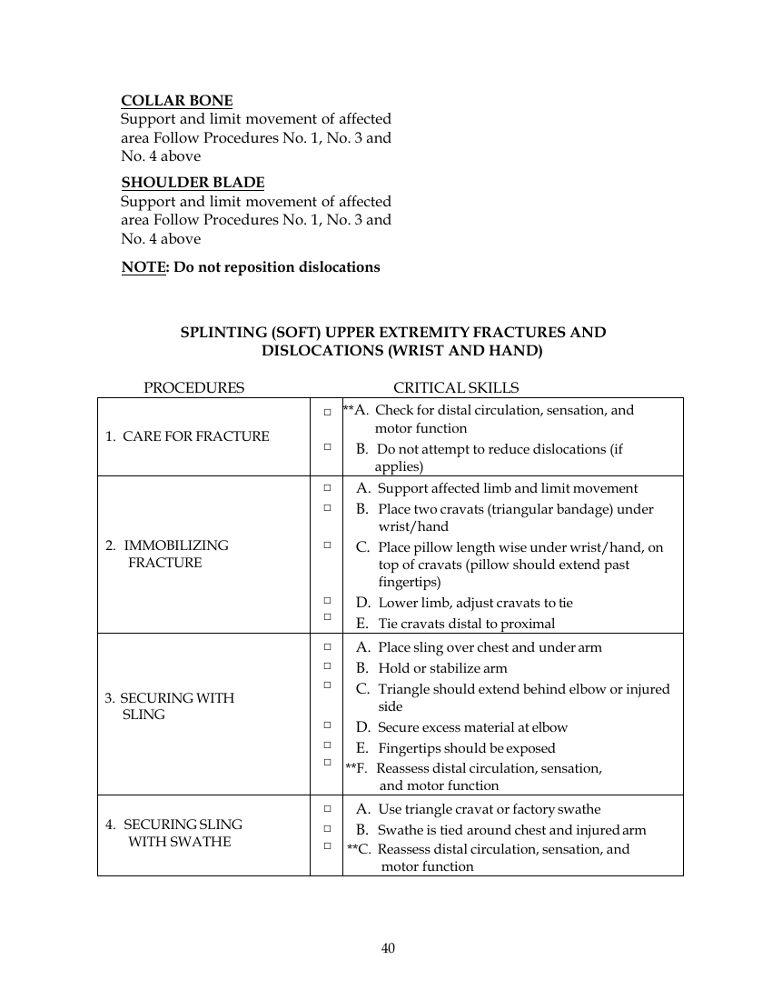


**15. Splinting (Rigid or Soft) Pelvic Girdle, Thigh, Knee and Lower Leg**

```
     PROCEDURES    CRITICAL SKILLS
                              □    **A. Assess for:
                                       Pain
  1. DETERMINE NEED
                                       Swelling
     FOR SPLINTING
                                       Deformity
                              □    B. Determine if splinting is warranted
  2. APPLY MANUAL    □    A. Support affected limb and limit movement
     STABILIZATION     Do not attempt to reduce dislocations
                              □    A. Select appropriate splinting method depending
  3. SELECT
                                      on position of extremity and materials available
     APPROPRIATE
                              □
     SPLINT    B. Select appropriate padding material
                              □    A. Remove or cut away clothing as needed
                              □
                                 **B. Assess distal circulation, sensation, and
                                      motor function
  4. PREPARE
    FOR    □    C. Cover any open wounds with sterile dressing
    SPLINTING    and bandage
                              □    D. Measure splint
                              □
                                   E. Pad around splint for patient comfort
                           □
                                A. Maintain support while splinting
                                Living Splint:
                           □    A. Immobilize the site of the injury
                           □    B. Carefully place a pillow or folded blanket
                                   between the patient’s knees/legs
                           □
                                C. Bind the legs together with wide straps or
                                   cravats
                           □
                                D. Carefully place patient on long spine board
                           □
                                 E. Secure the patient to the long spine board
                                    (if primary splint)
                           □
                                **F. Reassess distal circulation, sensation,
                                    and motor function
                                Padded Board Splint:
                           □    A. Splint with two long padded splinting boards
                                   (one should be long enough to extend from the
                                   patient’s armpit to beyond the foot. The other
                                   should extend from the groin to beyond the
                                   foot.) (Lower leg requires boards to extend from
                                   knee to below the foot.)
5. SPLINT
                           □    B. Cushion with padding in the armpit and groin
                                   and all voids created at the ankle and knee
                           □
                                C. Secure the splinting boards with straps and
                                   cravats
                           □    D. Carefully place the patient on long spine board
                           □
                                E. Secure the patient to the long spine board (if
                                   primary splint)
                           □
                               **F. Reassess distal circulation, sensation,
                                   and motor function
                                Other Splints:
                           □    A. Immobilize the site of the injury
                           □
                                B. Pad as needed
                           □    C. Secure to splint distal to proximal
                           □    D. Carefully place patient on long spine board
                           □
                                E. Secure the patient to the long spine board (if
                                   primary splint)
                           □    **F. Reassess distal circulation, sensation,
                                   and motor function
6. REASSESS    □    **A. Assess patient response and level of comfort
```

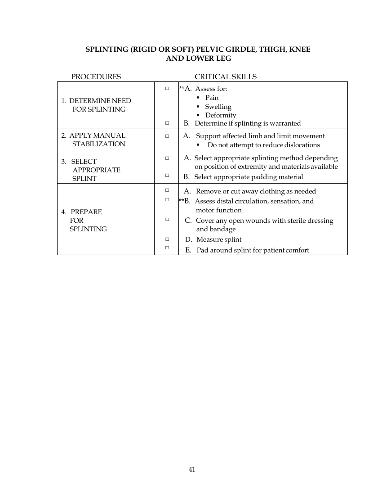

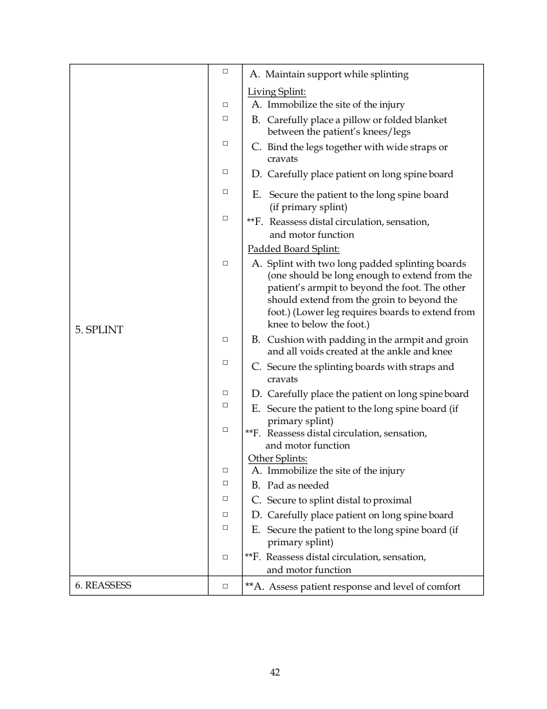


**16. Splinting (Soft) Lower Extremity Fractures and Dislocations (Ankle and Foot)**

```
  PROCEDURES    CRITICAL SKILLS
                           □ **A. Assess for distal circulation, sensation, and
1. CARE FOR    motor function
   FRACTURE    □
                                B. Do not attempt to reduce dislocations
                                   (if applies)
                           □    A. Support affected limb and limit movement
                           □
                                B. Place three cravats (triangular bandage) under
                                   ankle/foot
                           □    C. Place pillow length wise under ankle/foot, on
2. IMMOBILIZING    top of cravats (pillow should extend 6 inches
   FRACTURE    beyond foot)
                           □
                                D. Lower limb, adjust cravats to tie
                           □
                                E. Tie cravats distal to proximal
                           □
                                F. Elevate with blanket or pillow
                           □
                              **G. Reassess distal circulation, sensation, and motor
                                   function
```

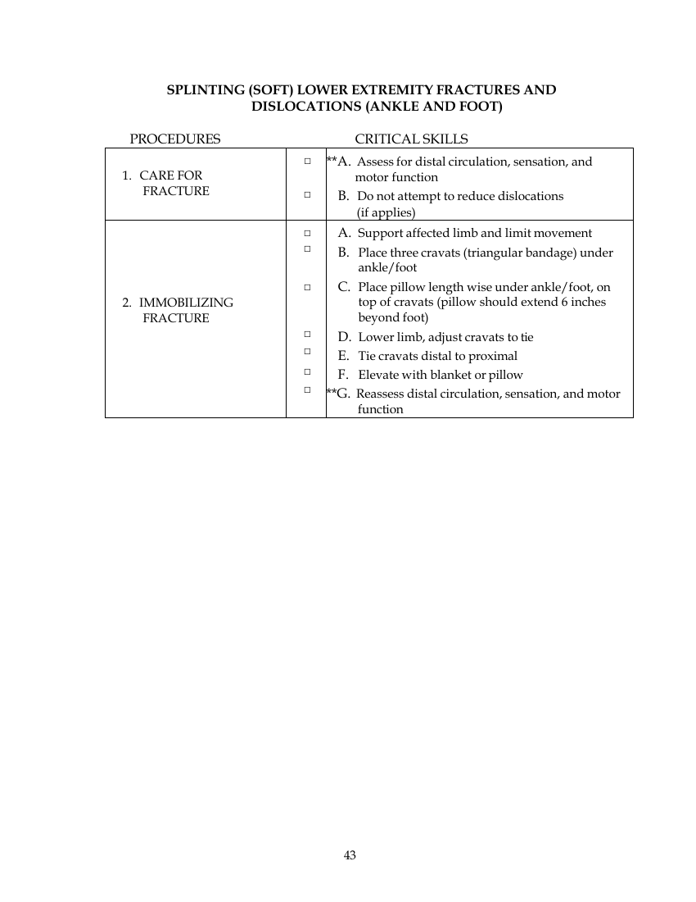


**17. Splinting Upper Extremity/Lower Extremity Fractures (Air Splint)**

```
    PROCEDURES    CRITICAL SKILLS
                              □ **A. Assess distal circulation, sensation, and motor
 1. CARE FOR FRACTURE
                                     function(fingers/toes)
                              □    A. Grasp above and below the injury site
                              □    B. Maintain support
                              □    C. Properly apply air splint
 2. IMMOBILIZE
    FRACTURE    □    D. Splint should be relatively free of wrinkles
                              □    E. Inflate splint to point that slight dent can be
                                     made
                              □
                                **F. Reassess distal circulation, sensation, and motor
                                     function (fingers/toes)
                              □ **A. Periodically check for increase or decrease
                                     in pressure
 3. MONITOR AIR-    □ **B. Monitor pressure in splint with fingertip
    INFLATED SPLINT    □    C. Make sure desired pressure is maintained
                              □
                                **D. Reassess distal circulation, sensation, and
                                     motor function (fingers/toes)
NOTE: Air splints may not be used with open (protruding bones) fractures.
        Air splints may only be used on the lower part of the extremities
        (from below the elbow on the arm and below the knee to the leg).
```

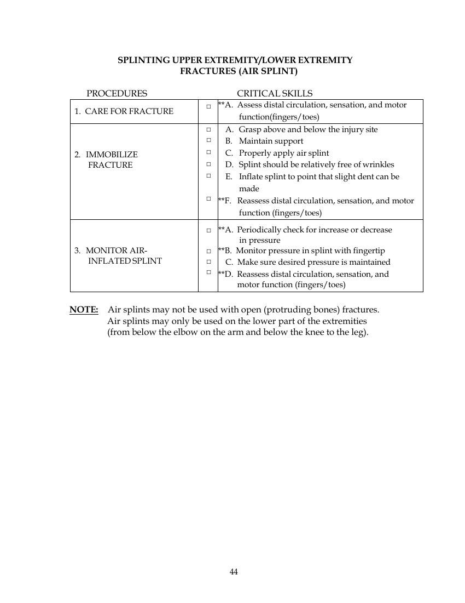


**18. Splinting – Flail Chest**

```
 PROCEDURES    CRITICAL SKILLS
                            □ **A. Assess for:
                                     • Pain
1. DETERMINE NEED
                                     • Swelling
   FOR SPLINTING
                                     • Deformity
                            □
                                *B. Determine if splinting is warranted
2. SELECT APPROPRIATE    □    A. Choose a pillow, blanket, trauma dressing, or
   SPLINTING MATERIAL    other appropriate splinting material
                            □    *A. Remove or cut away clothing as needed.
3. PREPARE
                            □    B. Cover any open wounds with sterile dressing
   FOR
                                    and bandage
   SPLINTING
                            □    A. Affix splint to chest with adhesive tape or roller
                                    bandage
                            □    B. Immobilize the site of injury
4. APPLY SPLINT
                            □    C. Use caution when taping splint to chest
                                    circumferentially
                            □    **D. Ensure sufficient chest expansion
5. REASSESS    □ **A. Assess patient response and level of comfort
6. ASSIST VENTILATIONS    □ **A. Assist with ventilation as needed
```

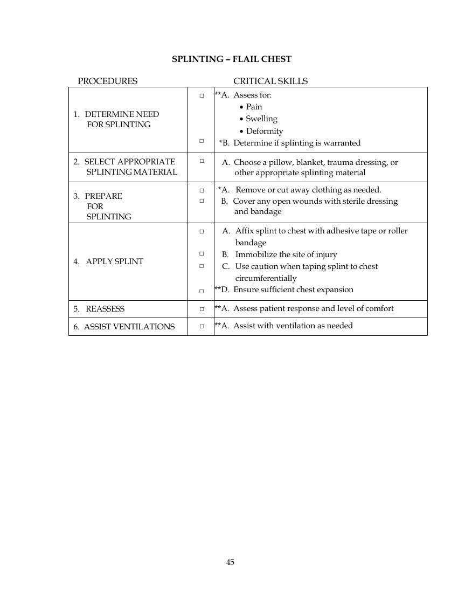


**19. One Rescuer Blanket Drag**

```
PROCEDURES    CRITICAL SKILLS
                           □    A. Properly prepare blanket for use in blanket
                                    drag
1. VICTIM SUPINE
                           □    B. Spread blanket alongside patient with
   ON GROUND
                                    approximately one half the width gathered
                                    lengthwise into pleats
                           □    A. Properly roll victim on one side
                           □    B. Take patients arm on side of body opposite to
2. POSITION PATIENT    blanket and extend arm over head
                           □
                                 C. Support head and neck roll patient on side
                                    away from blanket
                           □    A. Properly position on blanket
                           □    B. Hold patient on side while pleated portion of
                                    blanket is pulled in close to victim’s back
3. PLACE PATIENT    □    C. Roll patient onto blanket, extend opposite arm
   ON BLANKET    and roll onto opposite side
                           □
                                 D. Smooth out pleats and roll patient onto back
                           □
                                 E. Snugly wrap patient in blanket with arms at
                                    sides
                           □    A. Proper blanket drag of patient
4. PREPARE TO
                           □    B. Grasp portion of blanket beneath victim’s head
   DRAG PATIENT
                                    and drag victim to safety
```

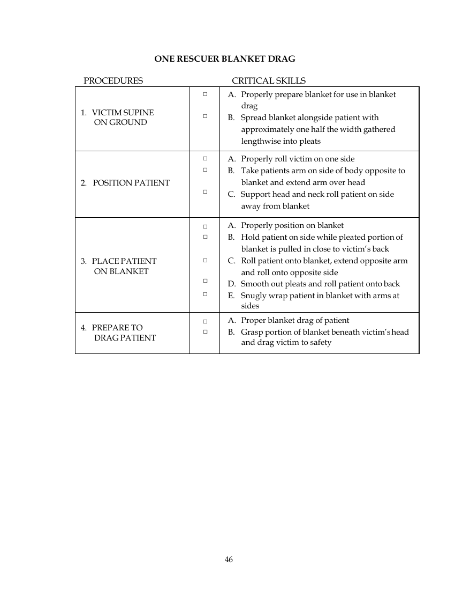


**20. Two Rescuer Extremity Ground Lift**

```
PROCEDURES    CRITICAL SKILLS
                           □    A. Rescuer 1 – Kneel at the head of the patient
                                     and place one hand under each of the
                                     shoulders
 1. POSITIONING
                           □    B.    Rescuer 2 – Kneel by the patient’s feet
                                     and grasp the patient’s wrist
                           □    A.    Direct rescuer 2-to pull patient into a sitting
                                     position.
 2. RAISING
                           □
    PATIENT TO A    B.    Rescuer 1–push patient’s shoulders up, slip
    SITTING    your arms under the patient’s armpits and
    POSITION    grasp wrist.
                           □
                                 C.    Rescuer 2–Gently pull-on patient’s arms
                           □    A.    Rescuer 1 –Once the patient is in a semi
                                     sitting position have rescuer 2 crouch down
                                     and grasp the patient’s legs behind the knees.
                           □
                                 B.    Rescuer 1-Directs rescuer 2 so you both stand
                                     at the same time. Then move as a unit when
 3. POSITIONING
                                     carrying the patient.
    AND LIFTING
                           □    C.    The rescuer at the head to direct the rescuer at
                                     the feet when to stop the carry and when to
                                     place the patient down in a supine or seated
                                     position.
```

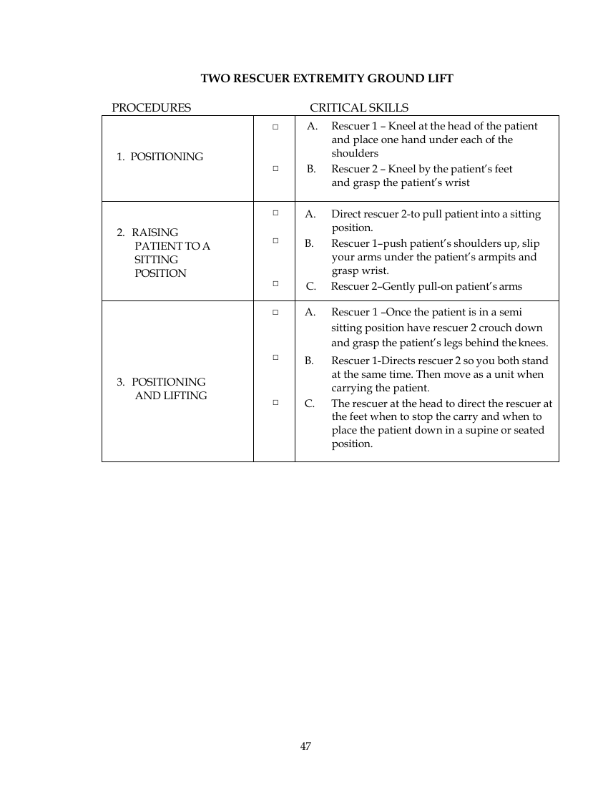


**21. Shirt Drag**

```
  PROCEDURES    CRITICAL SKILLS
                            □    A. Rescuer - Kneel at the head of the patient and
1. POSITIONING
                                      place one hand under each of the shoulders
                            □    A.    Rescuer – Grasp shirt at the shoulder area
                            □    B.    Drag patient in a straight (keep spine as
                                      straight as possible avoid dragging a patient
2. MOVING PATIENT
                                      sideways, by one arm, or one leg. A sideways
                                      drag can cause twisting motions of the spine
                                      that could aggravate existing injuries.)
                            □    A.    When using a drag to move a patient
                                      downstairs or down an incline, grab the
3. MOVING PATIENT
                                      patient under the shoulders and pull the
   DOWN STAIRS OR
                                      patient’s head first as you walk backward. If
   INCLINE
                                      possible, try to cradle the patient’s head in
                                      your forearms as you drag.
```

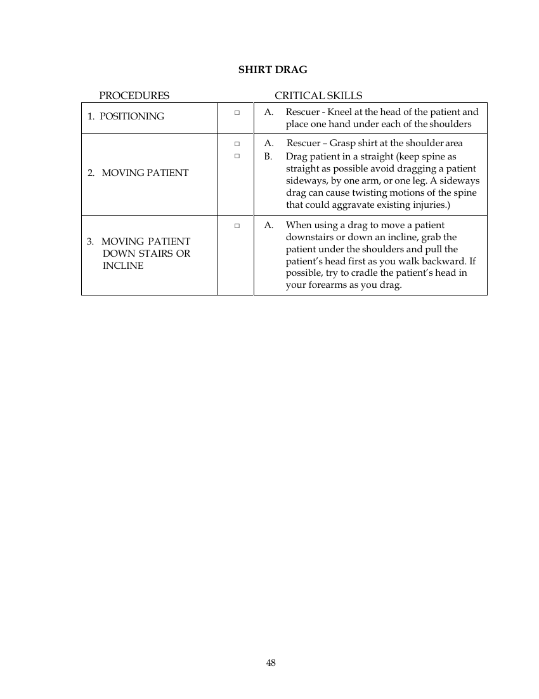


**22. Establishing Airway–Suspected Cervical Spine (Neck) Injury**

```
PROCEDURES    CRITICAL SKILLS
                           □    A. Rescuer – Position at top of the victim’s head
                           □    B. Restrain victim’s head and neck to avoid
1.    STABILIZE HEAD
                                    voluntary or involuntary
                                    movement/rotation of the neck
2.    ESTABLISH    □    A. Use modified jaw thrust maneuver without
    AIRWAY    causing over-extension of victim’s neck
                           □    A. Look for absence of breathing (no chest rise
3.    CHECK FOR    and fall) or gasping, which are not considered
    BREATHING    adequate (within 10 seconds)
                           □    **B. State that the victim is/is not breathing
4.    MAINTAIN OPEN
                           □    A.    Do not compromise suspected neck injury
    AIRWAY
```

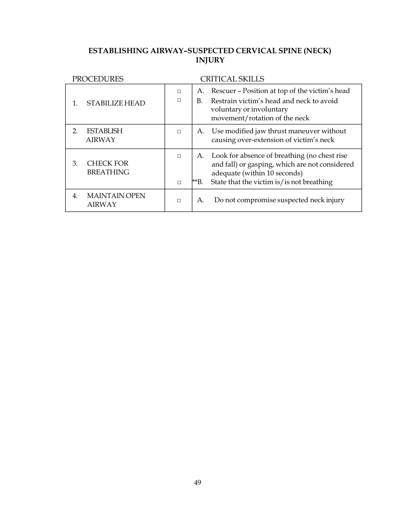


**23. Shock**

```
PROCEDURES    CRITICAL SKILLS
                           □    **A. Check restlessness; anxiety; altered mental
                                    status; increased heart rate; normal to
                                    slightly low blood pressure; mildly
1. CHECK FOR SIGNS    increased breathing rate: pale (or bluish) skin
  AND SYMPTOMS OF    (in victim with dark skin examine inside of
  SHOCK    mouth and nailbeds for bluish coloration).
                           □    **B.    Check for cool, moist skin; sluggish pupils;
                                     and nausea and vomiting.
                           □
                               **C.    Check for weakness
                           □    A. Ensure the ABCs are properly supported.
                           □    B. Control external bleeding.
                           □    C. Keep the patient in a supine position.
                           □    **D. Calm and reassure the patient and
                                    maintain a normal body temperature.
                           □    E. Cover with blanket to prevent loss of body
                                    heat and place a blanket under the patient.
2. TREATMENT    (Do not try to place blanket under patient
                                    with possible spinal injuries)
                           □    F. Continue to monitor and support ABCs
                           □    G. Do not give the patient anything by mouth.
                                    Do not give any fluids or food and be alert
                                    for vomiting.
                           □    **H. Monitor the patient’s ABCs at least every five
                                    minutes.
                           □
                                **I. Reassure and calm the patient
```

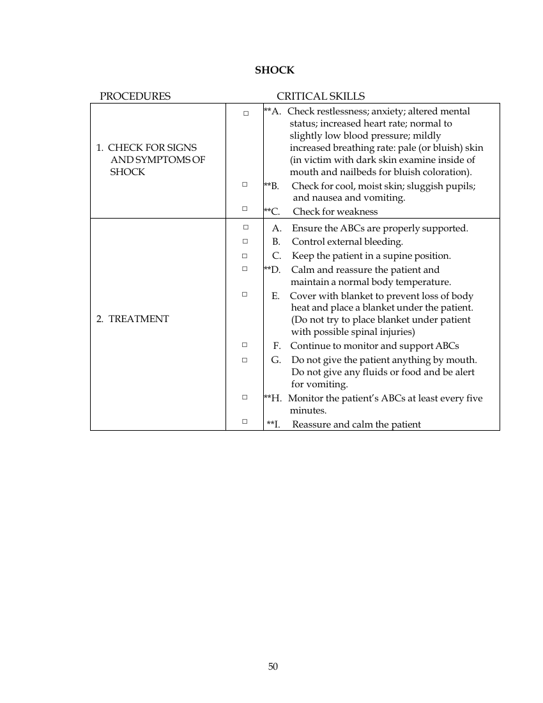


**24. Immobilization – Long Spine Board (Backboard)**

```
  PROCEDURES    CRITICAL SKILLS
                            □    A. Rescuer One at the head must maintain in-
                                     line immobilization of the head and spine
                            □    B. Rescuer One at the head directs the
                                     movement of the patient
                            □    C. Other Rescuers control movement of the rest
                                     of body
                            □    D. Rescuer Two position themselves on same side
                            □    E. Upon command of Rescuer One at the head,
1. MOVE THE    roll patient onto side toward Rescuer Two.
                            □    F. Quickly assess posterior body, if not
   PATIENT ONTO
   THE LONG SPINE    already done
                            □    G. Place long spine board next to the patient
   BOARD
                                     with top of board beyond top of head
                            □    H. Place patient onto the board at command of
                                     the Rescuer at head while holding in-line
                                     immobilization using methods to limit spinal
                                     movement
                            □    I.    Slide patient into proper position using
                                     smooth coordinated moves keeping spine in
                                     alignment
2. PAD VOIDS BETWEEN    □    A. Select and use appropriate padding
   PATIENT AND LONG    □
                                 B. Place padding as needed under the head
   SPINE BOARD    □
                                 C. Place padding as needed under torso
3. IMMOBILIZE BODY    □    A. Strap and secure body to board ensuring spinal
   TO THE LONG SPINE    immobilization, beginning at shoulder and
   BOARD    working toward feet
                            □    A. Using head set or place rolled towels on each
4. IMMOBILIZE HEAD
                                     side of head
   TO THE LONG SPINE
                            □    B. Tape and/or strap head securely to board,
   BOARD
                                     ensuring cervical spine immobilization
                            □    **A. Reassess distal circulation, sensation, and
5. REASSESS    motor function
                            □    **B. Assess patient response and level of comfort
```

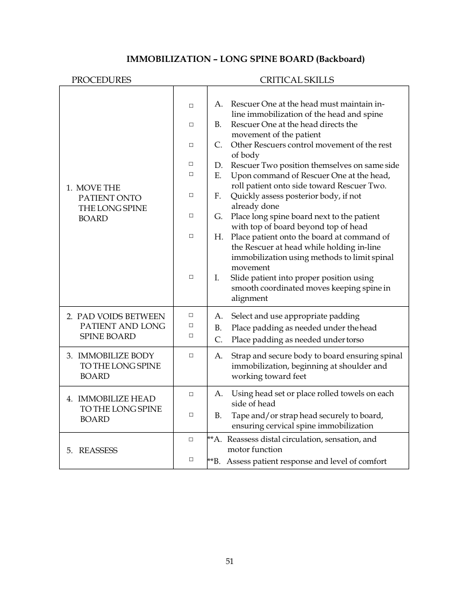


**25. Immobilization of Cervical Spine**

```
  PROCEDURES    CRITICAL SKILLS
                            □    A. Place head in a neutral, in-line position unless
                                     patient complains of pain, or the head is not
1. ESTABLISH AND    easily moved into position
   MAINTAIN IN-LINE    □    B. Place head in alignment with spine
   IMMOBILIZATION    □
                                 C. Maintain constant manual in-line immobilization
                                     until the patient is properly secured to a
                                     backboard with head immobilized
                            □
                                **A. Assess distal circulation, sensation, and motor
2. ASSESS CSM
                                     function (on all extremities)
                            □    **A. Inspect and palpate for injuries or signs of injuries
3. ASSESS CERVICAL
                            □    B. Remove clothing or jewelry as necessary
   REGION AND NECK
4. BANDAGE
                            □    A. Any neck wounds
   ANY WOUND
                            □    A. Apply properly sized collar or manual
                                     immobilization
                                 One piece C-collar
                            □    A. Select proper sized collar
                            □    B. Apply collar
                            □
                                 C. Ensure that patient’s head is not twisted during
5. APPLY CERVICAL    application
   SPINE    □    D. Ensure airway is open after placement
   IMMOBILIZATION    Two-piece C-collar
                            □    A. Select proper sized collar
                            □    B. Apply rear section to back of neck
                            □    C. Center rigid support on spine
                            □    D. Apply front section (overlaps rear section)
                            □    E. Ensure chin rests in chin cavity
                            □    F. Secure collar with Velcro straps
                            □    G. Ensure airway is open after placement
                            □    A. Immobilize patient to appropriate immobilization
6. SECURE HEAD TO    device
   APPROPRIATE    □    B. Use head set or place rolled blankets or towels on
   IMMOBILIZATION    each side of head
   DEVICE    □
                                 C. Tape and or strap head securely to appropriate
                                     immobilization device
                            □    **A. Reassess distal circulation, sensation, and
7. REASSESS    motor function
                            □    **B. Assess patient response and level of comfort
```

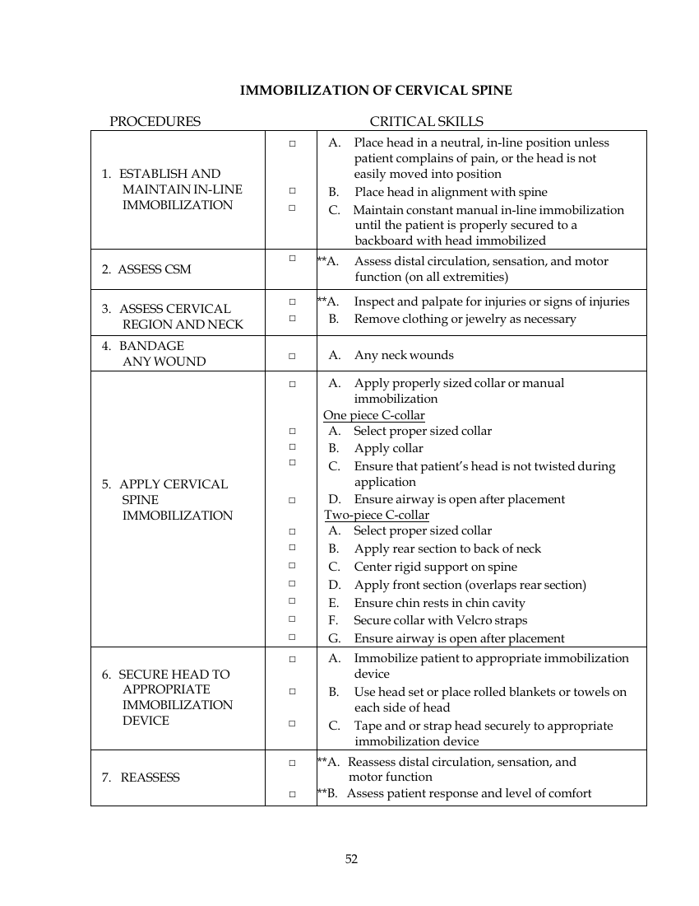


**26. Burns**

```
  PROCEDURES    CRITICAL SKILLS
                       □    **A. Determine type
 1. DETERMINE     Thermal
    BURN TYPE     Chemical
                                 Electrical
 2. DETERMINE
                       □
                           **A. Determine Body Surface Area (BSA) using rule
    BODY SURFACE
                               of nines
    AREA
                       □    *A. Remove patient from source of burn and
                               prevent further contamination
                       □    **B. Consider the type of burn and stopping the
                               burning process initially with water or saline.
                       □    C. Do not flush with water unless they involve an
                               area less than 9% of the total body surface area)
                       □    D. Remove smoldering clothing (do not remove
                               any clothing that is melted onto the skin)
                               jewelry
                       □
                           **E. Continually monitor the airway for evidence
                               of closure
4. BURN    □    F. Prevent further contamination. Keep the burned
   CARE    area clean by covering it with a dressing. Cover
   (All Types)    partial- and full-thickness burns with dry clean
                               dressings. In most cases place dry, sterile dressings
                               onto the burned area.
                       □    **G. Do not use any type of ointment, lotion or antiseptic
                       □
                           **H. Do not break blisters
                       □
                            **I. Ensure patient does not get hypothermic
                       □    J. If eyes or eyelids have been burned, place
                               dressings or pads over them. Moisten these pads
                               with sterile water if possible. Both eyes will be
                               covered.
                       □    K. If serious burn (partial or full-thickness burns)
                               involves the hands or feet, always place a clean pad
                               between toes or fingers when completing the
                               dressing.
                       □    A. Protect yourself from exposure to hazardous
                                materials
                       □
                            B. Wear gloves, eye protection, and respiratory
                               protection
                       □    **C. Flush the burned area for at least 20 minutes. (If
                               possible and it can be done quickly, try to identify
                               any chemical powders before applying water)
 4. CARE FOR    □
                            D. Apply a dry, clean dressing.
    CHEMICAL    □
                            E. If dry lime is the agent causing the burn, do not
    BURNS
                                flush with water. Instead use a dry dressing to
                                brush the substance off the patient’s skin, hair, and
                                clothing.
                       □    F. Remove any contaminated clothing or jewelry.
                       □    G. Once this is done, you may flush the area with
                               water.
                       □    H. Use caution not to contaminate uninjured areas
                               when flushing or brushing
                       □    **A. Ensure safety before removing patient from
 5. CARE FOR    the electrical source
                       □    **B. If the patient is still in contact with the electrical
    ELECTRICAL
    BURNS    source or you are unsure, do not approach or touch
                                the patient, contact power company
                       □    **C. Monitor the patient closely for respiratory
                                and cardiac arrest
                       □    D. Treat the soft tissue injuries associated with
                                the burn
                       □    **E. Look for both an entrance and exit wound
                       □ **A. Reassess level of consciousness (AVPU),
 6. REASSESS
                               respiratory status, and patient response
   Multiple burns will be treated as per procedures listed in patient assessment.
```

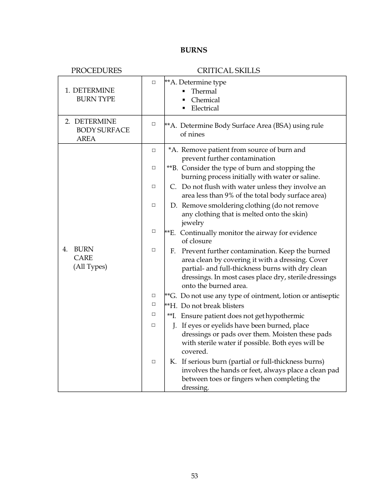

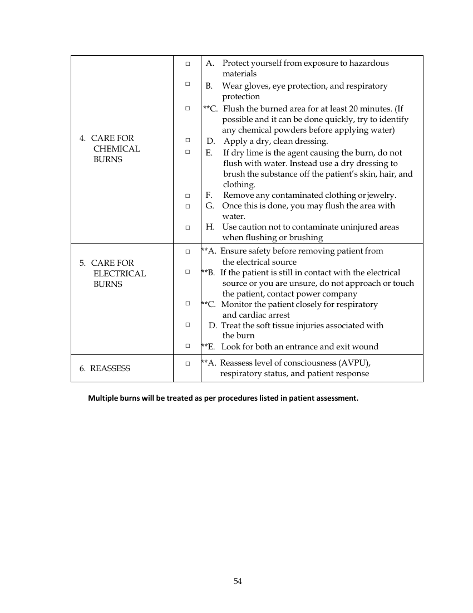


**27. Early or Superficial Frostbite**

```
 PROCEDURES    CRITICAL SKILLS
1. ASSESS FOR
                        □    **A. Patient exhibits signs and symptoms of
   FROSTBITE AND
                                frostbite or cold injuries
   COLD INJURIES
                        □    A. Blanching of the skin – palpitation of the skin
                                 in which normal color does not return
2. ASSESS FOR
                        □    B. Loss of feeling and sensation in the injured area
   EARLY OR
                        □    C. Skin remains soft
   SUPERFICIAL
                        □    D. If re-warmed, patient will feel a tingling
   FROSTBITE
                                 sensation
                        □    *A. Remove the patient from the environment
                        □    B. Protect the cold injured extremity from
3. TREAT EARLY
                                 further injury
   OR
                        □    *C. Remove wet or restrictive clothing
   SUPERFICIAL
                        □    D. Do not rub or massage
   INJURY
                        □    E. Do not re-expose to the cold
                        □ **A. Reassess level of consciousness (AVPU),
4. REASSESS
                                respiratory status and patient response
```

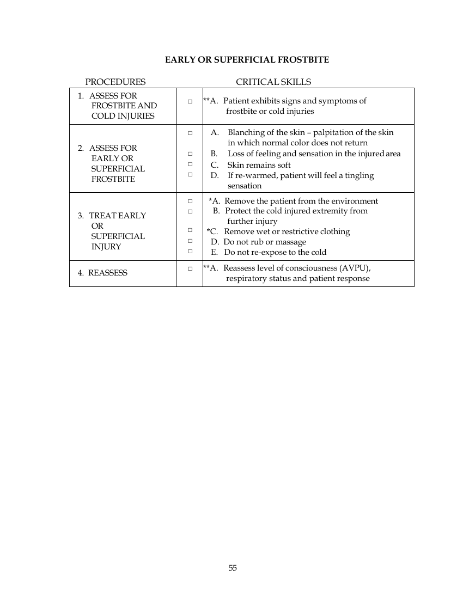


**28. Late or Deep Cold Injury**

```
 PROCEDURES    CRITICAL SKILLS
1. ASSESS FOR
                        □ **A. Patient exhibits signs and symptoms of
   FROSTBITE AND
                                frostbite or cold injuries
   COLD INJURIES
                        □    A. White, waxy skin
                        □    B. Firm to frozen feeling upon palpitation
2. ASSESS FOR    □    C. If thawed or partially thawed, the skin may
   LATE OR DEEP    appear flushed with areas of purple and
   COLD INJURY    blanching or mottled and cyanotic
                        □    D. Swelling may be present
                        □
                             E. Blisters may be present
                        □    *A. Remove the patient from the environment
                        □    B. Protect the cold injured extremity from
3. TREAT LATE OR
                                further injury
   DEEP COLD INJURY
                        □    *C. Remove wet or restrictive clothing
                        □    D. Remove jewelry
                        □
                             E. Cover with dry clothing or dressings
                        □
                           **F. Do not:
                                  Break blisters
                                  Rub or massage area
                                  Apply heat
                                  Re-warm
                                  Allow the patient to walk on the affected
                                   extremity
                        □ **A. Reassess level of consciousness (AVPU),
4. REASSESS
                                respiratory status and patient response
```

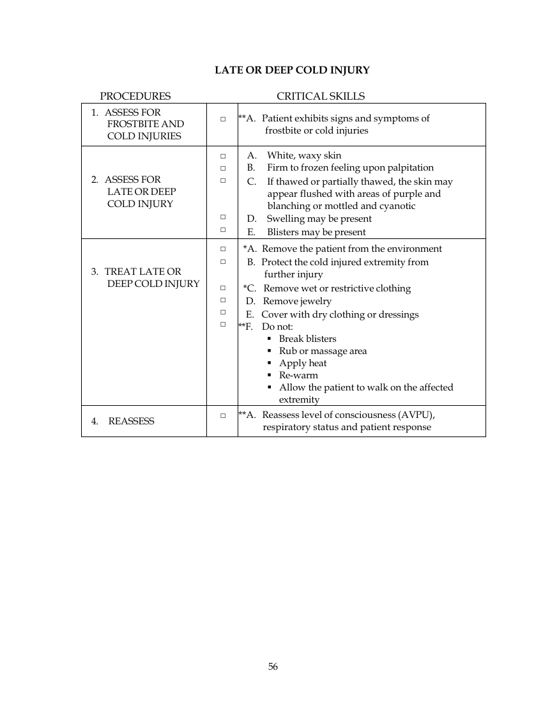


**29. Mild Hyperthermia (Heat Cramps-Exhaustion)**

```
PROCEDURES    CRITICAL SKILLS
                         □    **A. Patient exhibits signs and symptoms of
 1. ASSESS FOR
                                hyperthermia:
    HYPERTHERMIA
                                  Redness
                                  Muscular cramps
                                  Weakness or exhaustion
                                  Rapid heart rate
                                  Dizziness or faintness
                                  Altered mental status to unresponsive
 2. PREVIOUS    □    **A. Inquire about previous interventions attempted
    INTERVENTIONS
 3. ASSESS FOR    □    **A. Check skin for:
    MILD     Normal to cool temperature
    HYPERTHERMIA     Pale
    (HEAT     Moist
    EXHAUSTION)
                         □    **A. Place in a cool environment
                         □    **B. Loosen or remove clothing. Cool patient with water
 4. TREATMENT    spray or fanning
    FOR MILD    □    C. Put in supine position with legs elevated
    HYPERTHERMIA    □    **D. Consider giving small sips of water, juice, or
                                 sports drink.
                         □    E. If the patient is unresponsive or is
                                 vomiting, transport to the hospital
                         □    **A. Reassess level of consciousness
 5. REASSESS
                                 (AVPU), respiratory status and patient
                                 response
```

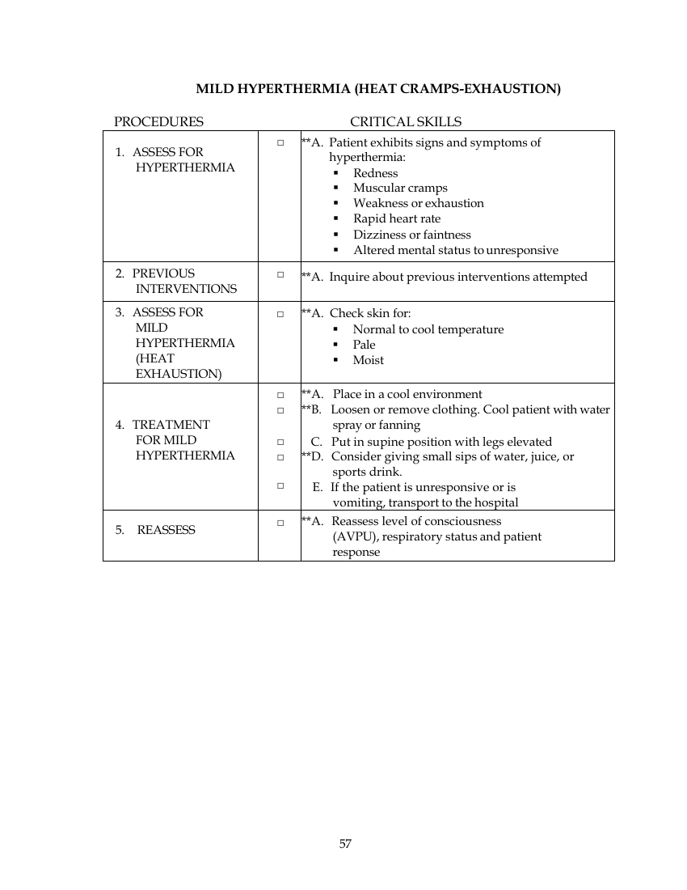


**30. Severe Hyperthermia**

```
         PROCEDURES    CRITICAL SKILLS
                        □    **A. Patient exhibits signs and symptoms of
1. ASSESS FOR    hyperthermia:
   HYPERTHERMIA     Redness
                                  Muscular cramps
                                  Weakness or exhaustion
                                  Rapid heart rate
                                  Dizziness or faintness
                                  Altered mental status to unresponsive
2. PREVIOUS
                        □    **A. Inquire about previous interventions attempted
   INTERVENTIONS
3. ASSESS FOR    □    **A. Check skin for:
   SEVERE     Hot temperature
   HYPERTHERMIA     Red
   (HEAT STROKE)     Dry or moist
                        □    **A. Place patient in a cool environment
                        □
                            **B. Wet patient skin by applying water from sponge
4. TREATMENT    or wet towels and fan
   FOR SEVERE    □    C. Put in supine position with legs elevated
   HYPERTHERMIA    □
                            **D. Offer drinking water if patient is responsive
                                 and not nauseated
                        □    *E. Apply cool packs to neck, groin and armpits
                        □
                            ** F. Transport immediately
                        □    **A. Reassess level of consciousness
5. REASSESS
                                 (AVPU), respiratory status and patient
                                 response
```

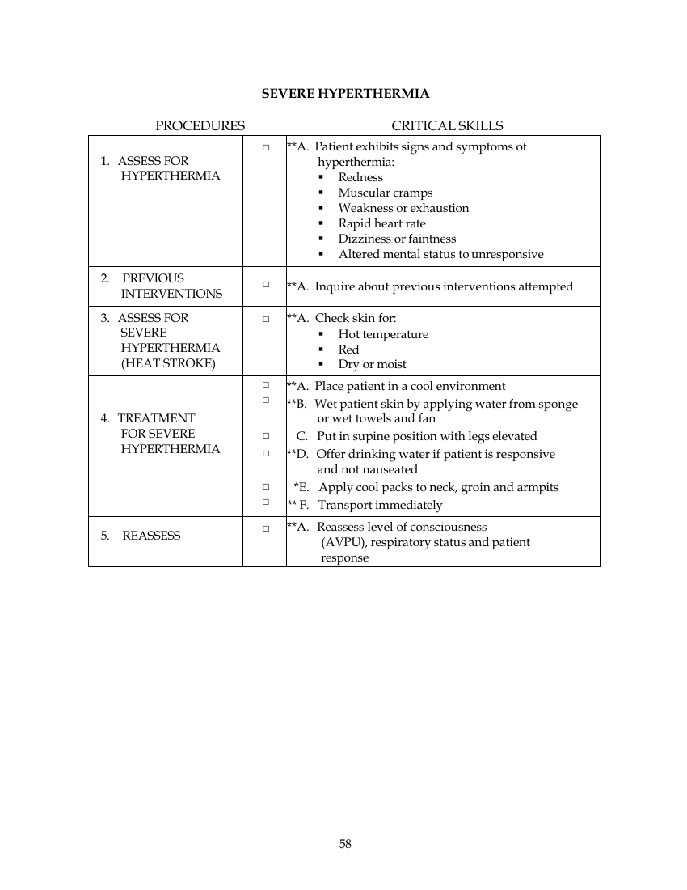
