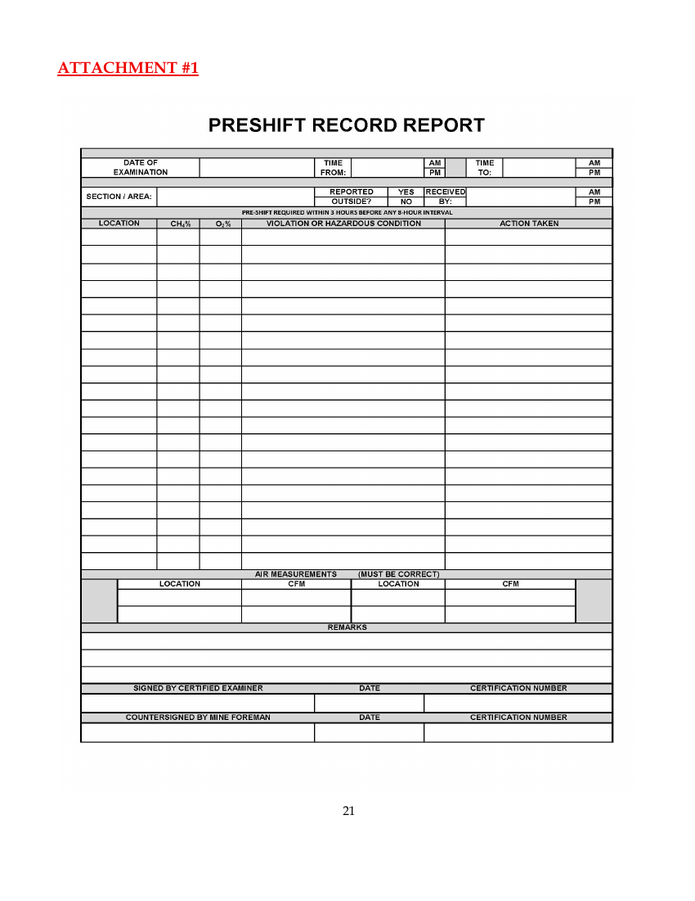

# 2026 Preshift Rules (Section VII of the 2026 Unified Mine Rescue Rules)

Edition: 2026, "Approved – 11/10/2025"  
Source: https://www.msha.gov/sites/default/files/Mine%20Rescue/VII-2026%20Preshift%20Rules.pdf

**Written exam:** 10 multiple-choice questions with three choices taken verbatim from the published statements of fact; each has a key-word blank (max two consecutive blanks; keywords cannot be shall/must/should); no "none of the above"; 15 minutes; one point per incorrect statement. (Preshift rule 6 (p. 3–4))

> The official PDF is a redline: red text is new for 2026 and red struck-through text is deleted. Deleted text was removed automatically (red glyphs crossed by a strike rule); additions are kept. Deletions removed: PDF p3: “report page on record page preshift record page”; PDF p5: “preshift record page record page/s page”; PDF p6: “preshift record page preshift record page”; PDF p10: “/or”; PDF p11: “Entering or remaining in”; PDF p13: “Preshift record page, to”

## Rules Governing 2026 Preshift Contest and Interpretations of Discount Cards  
*Rulebook pages 3–7*

**1.** Contestants should be certified as a mine foreman or examiner. College students or other entities who have someone who would like to compete may enter the contest as a non-certified foreman or examiner, they must use the following as their foreman certification number on the Preshift Record Report, (12345.) All certified foremen must use their respective foreman’s identification number.

**2.** Judges will be employees of the Mine Safety and Health Administration (MSHA), other assisting State Agencies or other judges approved by the contest director and/or chief judge.

**3.** Contestant must bring a safety cap, safety boots, mining belt with identification tag, check-in tag, MSHA-approved cap light, S.C.S.R. (may use training model, M20 or out-of-service SCSR as long as the contestant informs the judges of the specific defect[s]), MSHA approved anemometer, watch (with second hand or equivalent), an MSHA approved device to detect explosive and dangerous gases and/or deficiencies of oxygen, distance/area measuring devices, blank index cards (recommend at least 50, may be numbered) for placing dates, times and initials and writing instruments for recording their work. If a contestant cannot provide an S.C.S.R. due to air travel restrictions, you should notify the registrar upon sending the registration form and an S.C.S.R. will be provided. Contestants may bring personal items to the field provided the items do not contain prohibited information. Prohibited information means, but is not limited to, rules, calculating charts (i.e., ventilation formulas), and personal (“reminder”) notes.

**4.** A contest point system has been established. Failure to find and /or correct deficiencies or hazards, if necessary, failure of the contestant to verbally identify work, tests, or action being taken to the judge or failure to report in the Preshift Record Report will be assessed discounts. The accumulation of discounts will establish the contestants’ ranking in the contest. Three scoring segments will be used during the contest: written examination, underground (field), and the Preshift Record Report.

**5.** Preshift contestants shall be notified by posting when they may review the discounts and have the right to appeal in writing to the Chief Judge. Within one hour of posting, the contestant shall report to the designated location and may be accompanied by the trainer. Contestants will have 20 minutes to review and prepare any written protests. The Chief Judge will have the final decision on all appeals.

**6.** All contestants will take a written examination. The examination will consist of 10 multiple-choice questions with three choices, taken verbatim from the published statements of fact. Contestants will have 15 minutes to complete the written examination. One point will be discounted for each incorrect statement. Answers will not be intentionally misspelled. “None of the above” shall not be used as one of the choices. Each statement shall contain a blank space which shall represent a keyword taken verbatim from the published statements of fact, with no more than two consecutive blanks per statement. i.e., Keywords cannot be shall, must, should, etc. Only one choice should make the statement correct.

**7.** When the contestant arrives at the field (fire boss station) a minimum of two stopwatches, or one clock and a stopwatch will be provided at the station. The contestant will have two minutes to prepare (position their equipment, organize their clip board, read their notes, etc.). When the contestant is ready, they will start a clock/stopwatch, and a stopwatch will be started and carried by a judge. The contestant must start the clock/stopwatch within two minutes before beginning any field work. If the contestant fails to start the clock/stopwatch a judge will start the clock/stopwatch and the contestant will receive a discount 2 point under rule 1 on the field scorecard.

**8.** A maximum working time of 30 minutes will be in effect for the underground (field) portion of the contest. The contestant will be notified when there are five minutes left to complete the problem.

**9.** The portion of the mine to be examined will be addressed in a briefing prior to working the problem.

**10.** If during the problem, date, time, and initials need to be posted, the information shall be written on an index card and the card placed on the mine floor (or handed to one of the judges) at the required location. The contestant’s personal watch time will be the time used on the card.

**11.** The contestant’s personal watch time will be the time used on the preshift record for the time of examination.

**12.** Placards, objects, mine plans, and/or maps will be used to indicate equipment, conditions, or potential hazards. The lettering on the placards will be at least one inch in height. Contestants will not remove any items or placards unless specifically addressed in the problem. Any mobile equipment that may be moved must be marked as operable. Any object intended to be of an incorrect size must have the dimensions listed on a placard or have a similar object of the correct size elsewhere on the field.

For contest purposes only, all violations of 30 CFR, Part 75 (and mine plans given to the contestant (rule 17) prior to the contestant working the problem) will be considered a hazard.

**13.** During the working of the problem, contestants shall correct conditions or hazards, where means or materials have been provided. Where conditions can be corrected by physically moving an item or ventilation device, such action need not be indicated on an index card. Where conditions are not corrected, danger signs will be shown on index cards and placed on the mine floor (or handed to a judge). If multiple hazardous conditions exist in one area or entry, a separate danger card must be placed on the mine floor (or handed to a judge) for each hazard. EXAMPLE OF DANGER SIGN:

DANGER UNSAFE ROOF DANGER UNSAFE RIB 01/02/2026 10:00 A.M. 01/02/2026 10:00 A.M.

CJR CJR

**14.** The contestant will be provided the linear feet, width, height, or area dimensions, where air measurements are required during the working of the problem. Air measurements will be simulated, using the traverse method, for a minimum of 60 seconds. Calculators or similar devices will be allowed. Only whole numbers will be required to be stated in the preshift record. The final number/answer will not include any decimal. i.e., 15,000.8 will be recorded as 15,000. Do not round the answer up or down. Record whole numbers only.

**15.** Once the underground segment is completed, the contestant shall exit the mine, check out, and stop the clock. Once the clock is stopped the judges will return all of the danger cards to the contestant that were placed on the field/handed to the judges during the working of the problem. The contestant will not be allowed to reenter the mine after stopping the clock. The contestant will be escorted to the assigned area to fill out a Preshift Record Report. All notes, maps, danger cards, and contestants’ personal information will remain with the contestant until the preshift record page is completed. At that time the Preshift Record Report, notes, maps, and danger cards will be returned to the judge/guard and placed in the contestant’s packet. The contestant will have 20 minutes to complete the preshift record. The record of the results of the preshift examination will be documented in the Preshift Record Report (See Attachment #1 on Page 21). The standardized Preshift Record Report must be used for all contests. Discounts will be assessed for each item not recorded within the allotted time.

**16.** In the event an unforeseen problem arises, the time clock will be stopped, and the contestant will be removed from the field and taken to a neutral area. Following correction, the contestant will be returned to the field to complete the problem, and the time clock will be restarted. The field judges, prior to the completion of the problem, will adjust any discrepancies in the working time. At the completion of the problem, the contestant will be notified of any corrective actions concerning the working time.

**17.** Each Contestant must be under guard, in a designated location before the start of the contest. Contestants must remain continuously under guard until time to work the problem. Prior to going out to the field to work the problem, the contestant will be moved into a staging area and given a blank map, a written statement, and mine plans required for working the problem. The contestant will be given a minimum of 15 minutes to review the material and make any notes they deem necessary. The provided material will remain with the contestant until the contestant has completed the Preshift Record Report. Contestants who have performed will not be permitted to return to the isolation area or to communicate with any contestant awaiting their turn to perform.

**18.** No unauthorized person(s) will be allowed in the isolation area or on the contest field without permission from the Chief Judge.

**19.** Discounts will be assessed if the Preshift Record Report is not legible to the judges.

**20.** In the event of a tie, underground/field discounts will be the first tiebreaker, the preshift record will be the second, written examination will be the third, and the elapsed field working time will be the fourth tiebreaker.

**21.** All field discounts assessed to the contestant will be concurred by at least two Field Judges.

**22.** Judges should not talk with contestants during the working of the problem, other than to convey required information.

**23.** Immediately after the briefing, no communication between the contestant and any outside party will be allowed. Contestants receiving contest information after entering the isolation area will be disqualified.

**24.** Contestant shall not take any cell phones, computers, pagers, any device capable of sending and/or receiving information, etc. into the isolation area. The contestant may take reference material into the isolation area but cannot be used in the staging area. The contestant may not use any of this reference material when working the problem or taking a written exam. Contestants will not carry personal notebooks into the contest area.

**25.** All gas detecting instruments used or taken into the mine must be examined in the presence of the judges at the fire boss station after starting the clock. (Gas detecting instruments will be left on during the working of the problem.) If an instrument fails during the examination and the contestant takes corrective action with a backup instrument that has been examined in the presence of the judges, no discount will be assessed.

**26.** If an instrument fails any part of the test the contestant will receive a 2-point discount under Rule 13. If a spare detector or anemometer is used and works properly, the discount will not apply. Contestants using a detector that was discounted under Rule 13 would not be discounted for gas tests during the preshift contest.

**27.** Persons wishing to photograph or videotape the contest must receive permission from the Chief Judge/Contest Director.

## Interpretation of the Field Scorecard  
*Rulebook pages 8–12*

**1.** Failure to check in after starting the clock (2) and check out prior to stopping the clock (2). Maximum of 4

Contestant must start the time clock and check in before commencing any work other than reviewing the materials provided by the judges.

**2.** Failure to have required equipment. 2

Required equipment is safety cap, safety boots, mining belt with ID tag, check-in tag, cap light, S.C.S.R., anemometer, watch (with second hand or equivalent) and a MSHA approved device to detect explosive and dangerous gases and/or deficiencies of oxygen, distance/area measuring devices, blank index cards (recommend at least 50, may be numbered) for placing dates, times and initials and writing instruments for recording their work. Contestant shall have required equipment prior to leaving isolation area. A discount will be assessed for each omitted item.

**3.** Failure to visually examine self-contained self-rescuer and gas detector prior to entering the mine. 2 A 2-point discount will be assessed for each item not tested.

**4.** Failure to place date, time, and initials at required locations. 2 (each location) Date, time, and initials are to be placed where methane tests are required and on danger signs.

Date means correct month, day, and year.

Where hazard(s) are found and gas tests are required at the same location, only one date, time, and initial is required.

**5.** Failure to make necessary gas tests where required. 5 Methane and oxygen deficiency tests shall be taken:

A. In all roadways, travelways, and track haulage ways where persons are required to work or travel.

B. In all working places on the section and at areas where mechanized mining equipment is being installed or removed.

C. In areas where persons are scheduled to work, prior to the preshift examination.

D. At faces or last row of permanent roof support in rooms driven over 20-feet off intake air courses.

E. At seals along intake air courses.

F. At underground electrical installations, except; small handheld portable pumps, permissible pumps and associated permissible switchgear, and submersible pumps.

G. Immediately inby approaches to worked-out areas along intake air courses, and at high spots where methane is likely to accumulate, and equipment will be operated in the area during the shift.

H. In all accessible face areas, at the face or last row of permanent roof support.

I. Where the ventilation has been changed to remove excess methane (1% or greater) and/or oxygen deficiency (less than 19.5%), the examiner shall retest at the location of all placards where the gases were encountered during the initial examination.

If a placard is not present where a gas test is required, the reading shall be 0.0% CH4 and 20.9% O2.

**6.** Improper procedure when testing with gas detectors, testers, and indicators 2 (Maximum 4 discounts at each location)

A proper test for methane and oxygen deficiency shall require the following action by the examiner:

METHANE - Detector shall be held at eye level or higher OXYGEN DEFICIENCY - Detector shall be held at waist level or below. The contestant will verbally identify each test to the judge(s).

**7.** Failure to determine correct section ventilation and proper direction of the ventilating current. 10 (each location)

Failure to determine by air measurement the direction and volume of the ventilating air current. Failure to determine the correct direction of air current at regulators. Less than 9,000 cubic feet per minute (cfm) measured in the last open crosscut, or the intake end of a pillar line will be considered a hazard, unless otherwise stated in the written problem or other written instructions. Failure to ensure section ventilation is maintained as required by the approved ventilation plan.

**8.** Improper procedure when taking an air measurement. 2 (each location) Failure to traverse the entry/crosscut perpendicular to the ventilating current. Failure to measure the air current for 60-seconds.

Failure to measure height and width of area.

**9.** Not taking the required air measurement in the proper location prior to stopping the clock. (regulation) 5

The person conducting the preshift examination shall determine the volume of air entering each of the following areas if anyone is scheduled to work in the areas during the oncoming shift:

A. In the last open crosscut of each set of entries or rooms on each working section and areas where mechanized mining equipment is being installed or removed. The last open crosscut is the crosscut in the line of pillars containing the permanent stoppings that separate the intake air courses and the return air courses.

B. On each longwall or shortwall in the intake entry or entries at the intake end of the longwall or shortwall face immediately outby the face and the velocity of air at each end of the face at the locations specified in the approved ventilation plan.

C. At the intake end of any pillar line –

1. If a single split of air is used, in the intake entry furthest from the return air course, immediately outby the first open crosscut outby the line of pillars being mined; or

2. If a split system is used, in the intake entries of each split immediately inby the split point.

D. Any other location(s) required by the mine plans.

**10.** Improper procedure when examining and testing the mine roof 2 (each location) Failure to visually examine the mine roof. A discount will be assessed where the contestant fails to verbally state his/her visual examination of the mine roof at least one time in each entry.

**11.** Failure to verbally identify and correct a hazardous condition. 10 (each occurrence)

Discount will be assessed if the contestant fails to verbally identify hazardous conditions intended to be part of the problem.

Hazardous conditions must be corrected by the contestant during the examination when means or materials are available. However, preshift examiners are not required to install any roof support. If means or materials are not available, dangering off a hazardous condition will be considered acceptable corrective action.

**12.** Traveling at more than walking speed 5 (concurrence by two (2) judges required).

**13.** Contestant's equipment is not maintained in operable condition. 2 (each infraction)

Would include a cap lamp, a methane detector/oxygen indicator, and an anemometer. Discount will be assessed if the gas detection instrument or anemometer fails during the working of the problem and no other instrument is provided. Concurrence by two (2) judges is required.

**14.** Any act by the examiner, which may result in an explosion of an explosive air/gas mixture. 30 (each occurrence)

A. Changing conditions of the ventilation in such a manner that an explosive mixture is moved over an ignition source. i.e. Energized electrical equipment, energized circuits, (including all batteries except cap light batteries and hand-held permissible radios with batteries intact that are maintained in permissible condition) energized cables or any non-permissible equipment.

B. Encountering an explosive air/gas mixture in a face, or other area, and failing to take proper corrective actions.

An explosive mixture will be present when the methane is between five and fifteen percent inclusively and the oxygen is 12.1 percent or greater. Both methane and oxygen concentrations will be shown on the placards.

**15.** Any act by the examiner, which may endanger himself/herself or others. 20 (each occurrence)

A. Passing or not immediately retreating from an area known to contain an irrespirable atmosphere. Atmospheres containing less than 19.5 percent oxygen are irrespirable. Concentrations must be shown on the placard. Moving an irrespirable atmosphere over the contestant.

B. Encountering an adverse roof condition and failing to take adequate protective actions.

C. Traveling under unsupported or unsafe roof. (Self-explanatory.)

D. Traveling through water over knee deep. (For contest only)

E. Entering or remaining in smoke.

F. Crossing or working on belts in motion.

G. Disconnecting energized electrical circuits.

**16.** The contestant not following the written instructions for the working of the problem. 15 (each occurrence)

**17.** Failure to examine all accessible areas that can be safely traveled. 5 (each location) (Maximum 20 points) For contest purposes, “examine” means physical presence required.

**18.** Failure to comply with general rules not covered in the discount sheet. 2

## Interpretation of the Preshift Record  
*Rulebook pages 13–13*

**1.** Preshift Record Report not legible 2

Discount assessed for each illegible article; two judges must concur, not to exceed 30.

**2.** Failure to record the location of examination 2 (each omission)

**3.** Failure to record hazardous conditions 2 (each omission)

**4.** Failure to record action taken to correct hazardous conditions 2 (each omission)

**5.** Failure to record the date and time of examination 2

**6.** Failure to record results of air measurements 2 (each omission)

**7.** Failure to record results of methane (CH4) and oxygen (O2) examinations 2 (each omission)

**8.** Failure to certify by signature and foreman’s certification number 2

**9.** Failure to date entry of signature 2

**10.** If a contestant fails to take a gas test, air reading, or conduct work on the field during the working of the problem and records the information in the preshift record. 20 (each occurrence)

**11.** Failure to comply with general rules not covered in the discount sheet. 2

## Preshift Record Report (Attachment #1)  
*Rulebook pages 21–21*

> Blank standardized Preshift Record Report form (page image). Also published separately: https://www.msha.gov/sites/default/files/Mine%20Rescue/2026%20PRESHIFT%20RECORD%20REPORT%20-%20BLANK.pdf

